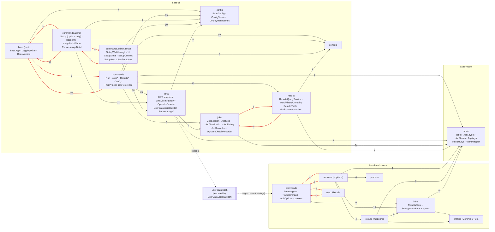

# Architecture review: current state (branch `codebase-review`, 2026-10-13)

Re-verified against 7d9660a on 2026-10-14.

Scope: `baas-cli`, `benchmark-runner`, `baas-model`, and the generated user-data shell. The review was read-only.
It was written against `dabbc55` and re-verified after the rebase onto `7d9660a`, which landed
`interactive-setup`: setup split into the package `commands.admin.setup`, `RunnerImageBuild` extracted
from `ImageBuildSubcommand`, setup creating the GitHub OIDC provider (ADR 0008), and `Hints.command`
naming the deployment in printed hints. `benchmark-runner`, `baas-model`, `jobs`, `results`, `config`
and `UserDataScriptBuilder` did not change, so the findings about them stand as written. Every
`file:line` below is at `7d9660a`.
The dependency data comes from a throwaway script that parses every `import pl.wsztajerowski…` in
`src/main/java` (wildcard imports included) and maps it to its package. Same-package
references need no import, so they are not counted, and only cross-package edges appear. Findings use
the prefix **B**. They avoid re-filing what `docs/review/open-findings.md` already holds (A4, A13, C4, S7,
N3, …) and what ADR 0005 declined (A1, the template method for the four runner services; U15, the
locale of the table).

---

## Summary

1. The CLI has a working **domain core for the job lifecycle**, built on ports (`JobSession`, `JobStop`, `JobTermination` over `JobRecorder` and `JobSession.Instances`). The runner has the same shape (`*SubcommandService` over `ResultsStore` and `StorageService`). Everything around those two cores is organised by technology, not by layer.
2. **The command classes are the application layer.** `RunCommand` (938 lines) and `TeardownCommand` (280) mix picocli parsing, use-case orchestration, domain rules (tag policy, watchdog bound, naming) and SDK client lifecycle. That is why `RunCommand.call()`'s success path has no JVM test. **Setup is now the exception.** `SetupCommand` (142 lines) only parses options and hands them to `SetupSteps.run`. The use case is eleven `SetupStep`s over one `SetupAws` port, tested against a fake (60 tests in `SetupStepsTest`). That is the shape B1 asks of `baas run`.
3. Three package cycles exist in the CLI. The first runs through the static `BaasApp.configService(spec)` locator and `LoggingMixin`. Since `7d9660a` it has four members: root↔commands↔admin↔admin.setup. The new `admin`↔`admin.setup` edge pair comes from `AwsSetupAws` calling `commands.admin.RunnerImageBuild`. jobs↔results is the second. The runner has one cycle of six packages.
4. **The three runtime components share less than CLAUDE.md implies.** `baas-model` owns keys, status and the job prefix. It does not own the artifact names inside the prefix, the job-item write the shell performs, the runner's argv, or the benchmark-type names. Each of these is spelled independently in Java and bash, with no in-process test across them.
5. AWS access has no general composition seam. Operator commands build concrete adapters from `AwsClientFactory`, and tests work around this by subclassing commands or faking SDK client interfaces. Setup now has a port (`SetupAws`), injected as a factory function. Deployer credentials still have no `OperatorSession` counterpart, though: `new AwsClientFactory(region, profile(deployerProfile))` still appears in four places, and one of them is now inside `AwsSetupAws`.

### Re-verification status (7d9660a)

| ID | Status | Note |
|---|---|---|
| B1 | Valid, relocated | `RunCommand.execute` is now `:300-496`. Setup shows the extraction B1 asks for |
| B2 | Valid | `UserDataScriptBuilder`, `DynamoDbJobRecorder` and `JobItemMapper` are unchanged |
| B3 | Valid, relocated | Only `RunCommand`'s boot-log literal moved (`:585` → `:596`) |
| B4 | Valid, relocated | The `RunCommand` project rule is now `:838-843`. The runner is unchanged |
| B5 | Valid, relocated | The root cycle grew to four packages with `commands.admin.setup`. The `BaasApp` locator is now `:101-120` |
| B6 | Changed | Setup has a port and a fake. Deployer wiring is still in four places, and teardown and the image commands have no seam |
| B7 | Changed | `SetupContext` keeps the invocation's own values apart and saves explicitly, but the steps still mutate `BaasConfig` in place |
| B8 | Valid, relocated | Moved into the setup steps, and widened: `GitHub*` parameter keys, plus a teardown read of `GitHubOrg` |
| B9 | Valid, relocated | The setup package is the first feature slice. `RunnerImageBuild` sits in `commands.admin` and calls back into a command |
| B10 | Valid, relocated | Same encoders, on shifted lines |
| B11 | Valid | The runner is unchanged |
| B12 | Changed | `baas-setup.mmd`, `c4-1` and `c4-4` were redrawn. `c4-3-component-cli`, `c4-2`, `baas-run` and `baas-build-image` still drift, and `baas-build-image` now also lacks the adopt-or-build step |
| B13 | Valid | `jobs` is unchanged |
| B14 | Valid | `baas-model` and `ResultsQueryService` are unchanged |

No finding was resolved or withdrawn. The last two sections say why.

---

## Current architecture

### Modules

| Module | Main code | Depends on | Notes |
|---|---|---|---|
| `baas-model` | 13 classes, 897 lines, one package `pl.wsztajerowski.baas.model` | `software.amazon.awssdk:dynamodb` (compile) | The enforcer `bannedDependencies` bans `org.mongodb:*` and `dev.morphia*` (`baas-model/pom.xml:44-51`). It holds pure contracts (`JobId`, `JobLayout`, `JobStatus`, `TagKeys`, `StoredMeasurement`, `JobItem`) **and** their DynamoDB encoding (`ResultKeys`, `MeasurementItemMapper`, `JobItemMapper`). |
| `baas-cli` | 89 classes, 12.4k lines (67 and 10.8k at `dabbc55`; the 21 setup classes are most of the growth) | `baas-model`, the SDK (ec2, ssm, cloudformation, s3, sts, iam, imagebuilder, dynamodb), picocli, jackson-yaml, slf4j | It also ships `cf-template-core.yaml`, `deployer-policy.json` and `runner-image.yaml` as classpath resources (`baas-cli/pom.xml:111-118`). It **generates the third component**, the user-data shell. |
| `benchmark-runner` | 53 classes, 3.1k lines, packages `pl.wsztajerowski.*` | `baas-model`, s3, dynamodb, mongodb-driver, morphia, gson, jsoup, picocli | It has no compile dependency on the CLI and the CLI has none on it. Their contract is argv plus the S3 and DynamoDB shapes. |
| user-data (bash) | `UserDataScriptBuilder.SCRIPT_BODY`, about 300 lines of bash in a Java text block | the AWS CLI on the AMI, IMDSv2 | It writes `environment.json`, `packages.txt` and `cloud-init-output.log`, writes job-item status itself, and invokes the runner. It is a component with its own contract that lives inside a CLI `infra` class. |

### What each CLI package actually owns

| Package | Classes | Owns |
|---|---|---|
| `baas` (root) | `BaasApp`, `LoggingMixin`, `BaasVersion` | The picocli root and command map. It is the **composition root and also a service locator**: `BaasApp.configService(spec)` and `deployment(spec)` (`BaasApp.java:101-120`) are called statically by every command (setup's steps are the exception: `SetupCommand` resolves both once and passes them in). It also owns failure reporting and the `-v` pre-scan. |
| `commands` | 16 classes: `RunCommand`, `Jobs*Subcommand`, `ResultsQuerySubcommand`, `Config*Subcommand`, `GitProject`, `JobReference` | Option parsing, payload rendering (JSON, CSV, tables), **and** each use case's orchestration. `GitProject` (a git subprocess) and `JobReference` (a job-id regex) are infrastructure and domain code that ended up here. |
| `commands.admin` | 8 classes: `SetupCommand`, `TeardownCommand`, `ImageBuildSubcommand`, `ImageShowSubcommand`, `RunnerImageBuild`, noun classes | Teardown and `image show` are still orchestrated inline over `infra` adapters. `SetupCommand` is now options only. `RunnerImageBuild` is the image-build use case, shared by `image build` and setup's image step, and takes an `AwsClientFactory` rather than ports. It calls `ImageBuildSubcommand.olderBaseRefusal` (`RunnerImageBuild.java:56`), so a use case depends on a command. |
| `commands.admin.setup` (new) | 21 classes: `SetupWalkthrough`, `SetupStep` and its eleven steps, `SetupSteps`, `SetupContext`, `SetupOptions`, `SetupAws` ⟂ `AwsSetupAws`, `Prompter`, `PolicyHandOver`, `RepeatCommand` | The setup use case as a step machine. Each step checks real state through the `SetupAws` port and returns `Next`, `Wait`, `Stop` or `GoTo`. `SetupContext` is the one mutable object the steps share. `AwsSetupAws` is the only class in the package that builds SDK clients (16 `factory.*()` sites). Steps still import SDK types: `StackStatus` (in the port itself, `SetupAws.java:5`), `SdkException` (`CredentialsStep.java:5`). |
| `config` | `BaasConfig`, `ConfigService`, `DeploymentNames`, `DeploymentNameRule`, `DeploymentSelectionException` | Persistence of `~/.baas/deployments/*.yaml` and the deployment-selection policy. `DeploymentNames` composes resource names. `BaasConfig` is also the in-memory "deployment" every use case receives. |
| `console` | `Console`, `Table`, `StatusLine`, `Watch`, `Hints` | Presentation only. This package is clean, with no outgoing project dependencies. |
| `infra` | 18 classes (unchanged set; `CloudFormationService.awaitSettled`, `ImageBuilderService.runningBuild`/adopt-or-build and `DeployerPreflight.isAccessDenied` are new) | AWS adapters (`CloudFormationService`, `Ec2ProvisioningService`, `ImageBuilderService`, `S3UploadService`, `SsmService`, `ParentImageResolver`, `BucketProbe`, `DeployerPreflight`), the client factory (`AwsClientFactory`), session and credential policy (`OperatorSession`), renderers (`UserDataScriptBuilder`, `RunnerImageRenderer`, `DeployerPolicyRenderer`), runner-image domain logic (`RunnerImageDefinition`, `RunnerImageParameters`, `RunnerImageExtension`, `RunnerImage`), and `RunnerJarResolver` (S3 plus GitHub HTTP). |
| `jobs` | `JobSession`, `JobStop`, `JobTermination`, `JobListing`, `JobRecorder`, `DynamoDbJobRecorder` | The job-lifecycle domain plus its port, **and** the DynamoDB adapter for that port. |
| `results` | `ResultsQueryService`, `ResultRow`, `ResultsFilters`, `ResultsGrouping`, `ResultsTable`, `EnvironmentManifest`, `PackagesDiff` | The DynamoDB query adapter, pure row logic, table presentation, and the job-environment manifest and diff (used only by `jobs show` and `jobs diff`). |

### What each runner package owns

| Package | Owns |
|---|---|
| `commands` | `TestWrapper` (the root), four subcommands that act as **composition roots** (they wire storage and store into a service through builders, e.g. `JCStressSubcommand.java:29-36`), and the `Api*Options` picocli mixins. These also build the results store (`ApiCommonSharedOptions.java:126`) and mint the job id and instant when they are absent (`:73`, `:97`). The package also holds the HTML result parsers (`HtmlParser`, `JCStressHtmlResultParser`). |
| `services`, `services.options` | One service per benchmark type: process, upload, then store. The options records are the application-level inputs. |
| `results` | Mapping a parsed result to `StoredMeasurement` (`JmhMeasurementMapper`, `JCStressMeasurementMapper`). `JmhRunResults` also uploads `jmh-result.json` (`JmhRunResults.java:42-44`). |
| `infra` | The ports `ResultsStore` and `StorageService`, their adapters (DynamoDB, Mongo, S3, Local), their builders, and `ResultLoaderService` (gson parsing). |
| `entities`, `entities.jmh`, `entities.jcstress` | Parse DTOs (`JmhResult`, `Metric`, `JCStressResult`), all Morphia `@Entity`, plus `MongoMeasurementDocument`. |
| `process` | `ProcessBuilder` wrappers. |
| root | `FileUtils` (the working directory, derived from where `TestWrapper`'s JAR lives) and `JavaWonderlandException`. |

### Component diagram: real package dependencies

The numbers on the edges are import counts. Red edges are part of a cycle.

### How AWS clients are created and passed

- **The factory.** `AwsClientFactory` (`infra/AwsClientFactory.java:27-111`) memoises the region and credentials and builds a **new SDK client per call** (`ec2()`, `s3()`, `dynamoDb(Duration)`, …). There is no container, no `IFactory` and no interfaces over the adapters.
- **Operator path.** Each operator command holds a lazy `OperatorSession session()` field built from `OperatorSession.of(BaasApp.configService(spec))`. The idiom is copied into 6 commands: `RunCommand.java:94-99`, `JobsTerminateSubcommand.java:43-48`, `JobsListSubcommand.java:69-74`, and Show, Diff, Download and ResultsQuery. `OperatorSession` resolves the deployment (file, or operator-role session), the region (file, or a `BucketProbe` lookup) and credentials (as-is, refused, or `AssumeRole`), then returns a deferred `AwsClientFactory` (`OperatorSession.java:120ish factory()`). Its STS and S3 needs go through a small `OperatorSession.Aws` port with a `REAL` implementation (`:233-263`). This is the best-factored part of the wiring.
- **Deployer path.** No session counterpart exists. `new AwsClientFactory(region, AwsClientFactory.profile(<deployer profile>))` is repeated in `AwsSetupAws.java:40`, `TeardownCommand.java:82`, `ImageBuildSubcommand.java:104` and `ImageShowSubcommand.java:54`. Each resolves the region in its own way: setup through `SetupContext.currentRegion()` (`SetupContext.java:120-128`, which falls back to `new BaasConfig().getAws().resolveRegion()` for the environment default), the other three through `config.getAws().resolveRegion()`.
- **Setup path (new in `7d9660a`).** `SetupCommand` holds `BiFunction<String, String, SetupAws> awsFactory = AwsSetupAws::new` (`SetupCommand.java:100`), and `SetupContext.aws()` rebuilds the port only when the region or profile changes (`SetupContext.java:131-139`). Steps see only `SetupAws`, whose answers are setup's own sealed types (`Preflight`, `OidcProvider`, `Image`). `AwsSetupAws` maps each call onto the existing `infra` services, opening one client per call. It assumes the operator role through `OperatorSession.REAL.assume` (`AwsSetupAws.java:151`), and it builds the image through `commands.admin.RunnerImageBuild` (`:205`). Tests replace the field with `FakeSetupAws`.
- **Adapters.** Elsewhere commands still `try (var cf = factory.cloudFormation()) { new CloudFormationService(cf)… }`, so the command owns the client lifecycle. Lines opening a client through `factory.*()`, per class: Run 11, Teardown 5, RunnerImageBuild 4 (moved out of ImageBuild, which has none now), JobsTerminate 3, JobsShow 3, ImageShow 2, and `AwsSetupAws` 16 (SetupCommand has none now, against 6 at `dabbc55`). `RunCommand` deliberately never closes the session's clients because the shutdown hook may still use them (`RunCommand.java:438-444`).
- **Runner.** Static builder factories (`StorageServiceBuilder.getS3ServiceBuilder()`, `ResultsStoreBuilder.builder()`, `ResultLoaderService.getResultLoaderService()`, `JCStressHtmlResultParser.getJCStressHtmlResultParser()`) are called from the subcommand, which injects the resulting ports into the service through its builder.

### How deployment configuration flows into commands

`--deployment` (inherited on `BaasApp`) feeds `BaasApp.configService(spec)`, which creates a `ConfigService(root, named)`. Admin commands then call `ConfigService.load()`, `loadForSetup()` or `loadForSync()` themselves. Setup now does it inside `DeploymentStep` (`DeploymentStep.java:76`) and keeps the result on `SetupContext.config`. Operator commands call `OperatorSession.config()`, which may build a fileless `BaasConfig` from the operator-role ARN. Either way the result is a **mutable `BaasConfig` Jackson bean**, passed to every use case as "the deployment". Its derived names (`bucket()`, `resultsTable()`, `stackName()`, `BaasConfig.java:67-78`) delegate to `DeploymentNames`. Runner networking comes from stack outputs on every job (`RunCommand.resolveNetworking`, `:184-204`), never from the file.

### How the CLI and the runner share contracts

| Contract | Owner | CLI use | Runner use | Shell use |
|---|---|---|---|---|
| Measurement item, keys, GSI | `MeasurementItemMapper`, `ResultKeys` | `ResultsQueryService` | `DynamoDbResultsStore`, `MongoResultsStore` | none |
| Job item | `JobItemMapper`, `ResultKeys.jobSortKey`, `JobStatus` | `DynamoDbJobRecorder` | none | **Hand-written** `update-item` JSON (`UserDataScriptBuilder.java:44-58`). Only the sort key and the guard expression come from Java. |
| Job prefix | `JobLayout.jobPrefix` | `RunCommand.java:389` | Default only, when `--result-path` is absent (`ApiCommonSharedOptions`) | Receives `RESULT_PATH` |
| Artifact names inside the prefix | **nobody** | literals | literals | literals (B3) |
| Tag vocabulary | `TagKeys` | `RunCommand.buildRunnerTags` | `getProject` reads `TagKeys.PROJECT` | Observed keys as literals (`UserDataScriptBuilder.java:269-274`) |
| Runner argv, flag names and type names | **nobody** | `UserDataScriptBuilder.java:261-276`, `RunCommand.java:85` | picocli annotations | renders them (B4) |
| Manifest schema | `UserDataScriptBuilder.MANIFEST_SCHEMA_VERSION` (writer); `EnvironmentManifest.GROUPS` (reader) | both in the CLI | none | heredoc |
| Version lockstep | `BaasVersion`, `JobLayout.runnerJarKey` | pins `releases/<cliVersion>/` | none | downloads it |

---

## Dependency matrix and cycles

Rows import columns, by import count. `.` means none. Self-edges are omitted.

### CLI and model

`setup` is `commands.admin.setup`, new in `7d9660a`. Changed cells against `dabbc55`: admin→config 11→9, admin→console 2→5, admin→infra 29→27, and the whole `setup` row and column. Every other cell is unchanged.

| from \ to | root | commands | admin | setup | config | console | infra | jobs | results | model |
|---|---|---|---|---|---|---|---|---|---|---|
| **root** | . | 5 | 1 | . | 2 | . | . | . | . | . |
| **commands** | **26** | . | . | . | 19 | 22 | 30 | 8 | 13 | 7 |
| **admin** | **11** | . | . | **4** | 9 | 5 | 27 | . | . | . |
| **setup** | . | . | **1** | . | 10 | 3 | 18 | . | . | . |
| **config** | . | . | . | . | . | . | . | . | . | . |
| **console** | . | . | . | . | . | . | . | . | . | . |
| **infra** | . | . | . | . | 4 | . | . | 2 | . | 3 |
| **jobs** | . | . | . | . | . | . | . | . | **1** | 14 |
| **results** | . | . | . | . | . | 4 | . | **1** | . | 7 |
| **model** | . | . | . | . | . | . | . | . | . | . |

SDK imports by package: `infra` imports cloudformation, dynamodb, ec2, iam, imagebuilder, s3, ssm, sts. `jobs` and `results` import dynamodb. `commands.admin` imports **none** now (at `dabbc55`, `SetupCommand` imported cloudformation and dynamodb). `commands.admin.setup` imports cloudformation (`StackStatus`, in the port, `SetupContext`, `StackStep`, `NamesStep` and the adapter), dynamodb and iam (exception types, adapter only), and `core.exception.SdkException` (`CredentialsStep.java:5`). `commands` imports `AwsServiceException` (`RunCommand.java:39`). `model` imports dynamodb.

### Runner

| from \ to | commands | entities | ent.jcstress | ent.jmh | infra | root | process | results | services | options | model |
|---|---|---|---|---|---|---|---|---|---|---|---|
| **commands** | . | . | 3 | . | 6 | **5** | . | . | **4** | 5 | 3 |
| **entities** | . | . | . | . | . | . | . | . | . | . | 1 |
| **infra** | . | 1 | . | 1 | . | **2** | . | . | . | 1 | 5 |
| **root** | **1** | . | . | . | . | . | . | . | . | . | . |
| **process** | . | . | . | . | . | **1** | . | . | . | 1 | . |
| **results** | . | . | 1 | 2 | **2** | . | . | . | . | 1 | 7 |
| **services** | **1** | . | 1 | 2 | 19 | 4 | 6 | 4 | . | 18 | 4 |

### Strongly connected components (cycles)

1. **CLI `{baas, commands, commands.admin, commands.admin.setup}`.** Every command imports `LoggingMixin` and calls `BaasApp.configService(spec)` (26 plus 11 imports), while `BaasApp` imports every noun to register it. Evidence: `BaasApp.java:13-18` against `RunCommand.java:12-14` and `SetupCommand.java:9-10`. `commands.admin.setup` joined the cycle in `7d9660a`, through a two-package loop of its own: `SetupCommand` imports `AwsSetupAws`, `SetupAws`, `SetupOptions` and `SetupSteps` (`SetupCommand.java:11-14`), and `AwsSetupAws` imports `commands.admin.RunnerImageBuild` (`AwsSetupAws.java:3`) for `buildImage`. The setup package itself imports neither `BaasApp` nor `LoggingMixin`.
2. **CLI `{jobs, results}`.** `JobListing` uses `ResultsFilters::pair` (`JobListing.java:5,61`). `ResultsQueryService.resultPathForJob` creates a `DynamoDbJobRecorder` (`ResultsQueryService.java:6,197`).
3. **Runner `{commands, services, infra, results, process, root}`.** `JCStressSubcommandService.java:20` imports `commands.JCStressHtmlResultParser`. `FileUtils.java:3,10` imports `commands.TestWrapper`. The `commands` package imports `FileUtils` and `JavaWonderlandException` from the root, and `infra` and `process` also import the root. `results` imports `infra` (`StorageService`, `ResultLoaderService`).

`baas-model` and `console` are leaves, as they should be. `config` is a leaf as well.

---

## Layer map

Layers: **P** is presentation (picocli, rendering, `Console`). **A** is application or use-case orchestration. **D** is domain rules. **I** is an infrastructure adapter (SDK, process, HTTP, filesystem). A row with more than one letter means **mixed in one class**.

| Class or package | Layers occupied | Where the mixing is |
|---|---|---|
| `BaasApp` | P + composition root + **service locator** | `configService(spec)` and `deployment(spec)` are static lookups into the picocli root (`:101-120`) |
| `RunCommand` | **P + A + D + I** | P: options, JSON summary (`:918-933`), hints (`:280-298`), status line. A: `execute()` (`:300-496`). D: tag policy (`:827-870`), `watchdogBound` (`:767`), project name (`:720-735`), `VALID_TYPES` (`:85`). I: client lifecycle, `AwsServiceException` parsing (`:564`), stack-output keys (`:190`), launch-error report (`:574-590`) |
| `SetupCommand` | P (+ D: the federation-option rule) | Options, `validateFederationOptions` (`:120-141`), and one call to `SetupSteps.run` (`:109-112`). At `dabbc55` it was P + A + D + I in 627 lines |
| `setup.SetupWalkthrough`, `SetupStep`, `SetupSteps` | A | The step machine: `Next`/`Wait`/`Stop`/`GoTo`, and Enter to re-check. It imports `DeployerPreflight.isAccessDenied` from `infra` (`SetupWalkthrough.java:5`) to turn a late denial into the policy hand-over |
| `setup.*Step` (11 classes) | A + D (+ P through `Prompter` and log text) | Domain rules now sit in steps: the default-name rule `computePrefix` (`NameAndRegionStep.java:93-98`), the name-conflict rule (`NamesStep.java:60-85`), federation diff and subject patterns (`GitHubStep.java:121-188`), the evidence rule for storing a profile (`DoneStep.java:47-60`). Steps read and write `SetupContext` and never each other |
| `setup.SetupContext` | A (invocation state) | The run's answers in typed fields, apart from the persisted `BaasConfig config` it also carries (B7) |
| `setup.SetupAws` | port | Setup-shaped sealed answers. It still leaks SDK `StackStatus` (`:5`, `:64`, `:67`). Its create failure is `infra`'s `CloudFormationService.StackOperationException` (documented at `:84`, caught in `StackStep.java:68`) |
| `setup.AwsSetupAws` | I (+ a little D) | Maps the port onto `infra` services. `image()` holds a version comparison (`:174-188`), and `buildImage` delegates to `commands.admin.RunnerImageBuild` |
| `setup.Prompter`, `PolicyHandOver`, `RepeatCommand` | P (+ I: `PolicyHandOver.write` writes the file) | Terminal prompts, the policy as stdout payload, the repeat command line |
| `TeardownCommand`, `ImageShowSubcommand` | P + A + I | They orchestrate the CF, Image Builder, EC2, S3 and SSM adapters inline |
| `ImageBuildSubcommand` | P + D | Reads and checks the extension file, then calls `RunnerImageBuild.run` (`:108`). Owns the domain rule `olderBaseRefusal` (`:51-60`), which the use case calls back |
| `commands.admin.RunnerImageBuild` (new) | A + I wiring | The build use case (register in the stack, preflight, publish), shared with setup. It takes an `AwsClientFactory` and opens four clients (`:45-48`), so it has no port |
| `Jobs{List,Show,Diff,Download,Terminate}Subcommand` | P + A (+I wiring) | Thin. `JobsShowSubcommand.Sources` is a command-local port (`:77-111`). `JobsDiffSubcommand` builds S3 keys by hand (`:125`, `:199`) |
| `ResultsQuerySubcommand` | P + A | It holds the JSON, CSV and table writers, the picker, the watch loop, and the filter pipeline. The shared `jsonString` and `csvField` are used by four other commands |
| `Config*Subcommand` | P + A | `ConfigSync` mutates the config, sets the region to null, then restores it (`ConfigSyncSubcommand.java:70-90`) |
| `commands.GitProject` | I | A git `ProcessBuilder` inside the commands package |
| `commands.JobReference` | D | It re-encodes the `JobId` format as a regex (`:14`) |
| `config.BaasConfig` | persistence DTO + D | Names (`:67-78`) and region resolution from env (`:155-163`) live on a mutable Jackson bean |
| `config.ConfigService` | I (filesystem) + A (selection policy) | Acceptable. The policy text sits next to the I/O |
| `config.DeploymentNames`, `DeploymentNameRule` | D | Clean |
| `console.*` | P | Clean |
| `infra.OperatorSession` | A + I | Deployment selection and credential policy over the `Aws` port, with `REAL` in the same class. A good seam |
| `infra.AwsClientFactory` | I | Clean |
| `infra.{CloudFormation,Ec2Provisioning,ImageBuilder,S3Upload,Ssm}Service` | I | Concrete classes over SDK clients. `CloudFormationService.stackStatus` returns SDK `StackStatus` (`:282`). `S3UploadService` also downloads, lists and deletes (it is misnamed). `Ec2ProvisioningService` implements `JobSession.Instances` (the infra→jobs edge) |
| `infra.UserDataScriptBuilder` | **third component**, D (contract) | It is a bash program. It imports `jobs.DynamoDbJobRecorder` for the guard (`:5`, `:335`, `:348-353`) |
| `infra.RunnerImage{Definition,Parameters,Extension}` | D | Image versioning and extension rules, placed in `infra` |
| `infra.RunnerImageRenderer`, `DeployerPolicyRenderer` | D (rendering) | Pure apart from classpath reads |
| `infra.DeployerPreflight`, `BucketProbe`, `ParentImageResolver` | I (+D for policy probing) | `BucketProbe` is a sealed result type with an injected client function. A good seam |
| `infra.RunnerJarResolver` | I + D (integrity) | Static methods over `S3Client` and a static `HttpClient` |
| `jobs.JobSession`, `JobStop`, `JobTermination`, `JobListing` | D + A | Port-based, with clock and sleeper injected. EC2 state strings leak in (B13) |
| `jobs.JobRecorder` | port | Clean |
| `jobs.DynamoDbJobRecorder` | I | An adapter that sits in a domain package and also hosts a cross-component contract (`NOT_TERMINAL`) |
| `results.ResultsQueryService` | I | Owns the client (`close()`), re-declares attribute names (`:46-48`), and calls the job adapter |
| `results.ResultRow`, `ResultsFilters`, `ResultsGrouping` | D | Clean |
| `results.ResultsTable` | P | Lives in `results` (the results→console edge) |
| `results.EnvironmentManifest`, `PackagesDiff` | D | They describe the job environment but sit in `results` |
| `baas-model` mappers | I (DynamoDB encoding) | Shared on purpose. Pure contracts share the package |
| runner `commands.*Subcommand` | P + composition root | Clean |
| runner `commands.ApiCommonSharedOptions` | P + factory + D | `buildResultsStore()` (`:126`), id and instant minting (`:73`, `:97`), project precedence (`:107`) |
| runner `commands.JCStressHtmlResultParser`, `HtmlParser` | I (parsing) | In the presentation package |
| runner `services.*Service` | A | Clean, over ports. A1 was declined in ADR 0005 |
| runner `results.JmhRunResults` | A + I | Upload side effect inside "map" (`:42-44`) |
| runner `infra.*` | port + I | The ports live with their adapters |
| runner `entities.jmh`, `entities.jcstress` | DTO with Morphia annotations | The DynamoDB path's parse types carry `@Entity` (`JmhResult.java:9`) |

---

## Findings

### B1: The `baas run` use case lives inside `RunCommand`, so the main path cannot be tested · Should · M

- **Status (7d9660a): Valid, relocated.** Only hint text changed in `RunCommand`.
- **Location:** `baas-cli/.../commands/RunCommand.java:300-496` (`execute`), `:559-639`, `:699-707`.
- **Evidence:** One 200-line method runs these steps in order:
  1. resolve the project and the table;
  2. validate tags;
  3. look up the image (`ImageBuilderService`, built from three raw clients at `:363-365`);
  4. read the networking outputs;
  5. name the job;
  6. upload, or seed the pinned runner;
  7. render user-data;
  8. wire `JobSession` to two `DynamoDbJobRecorder`s and `Ec2ProvisioningService`;
  9. reserve, register the hook, launch, confirm, poll, and report.

  Each step constructs its own adapter from `AwsClientFactory`. The only seams are package-private helpers (`buildRunnerTags`, `afterLaunch`, `reportJobResults`, `resolveTimings`). CLAUDE.md states the gap itself: "`RunCommand.call()`'s success path is executed by no JVM test". The 73 tests in `RunCommandTest`, `RunCommandDetachTest` and `RunCommandSummaryTest` cover the helpers and the failure paths that end before AWS.
- **Recommendation:** Extract a `JobLaunch` (or `RunJob`) use case into `jobs`. It should take a `RunRequest` value (type, params, project, tags, timings, JARs) and narrow ports for the image catalogue, stack networking, artifact store, runner-JAR source, `JobRecorder` and `Instances`. It should return a `RunReport` that `RunCommand` renders. Keep the shutdown-hook ownership in the command, or in a small `JobGuard`, because the hook is a process concern. `JobSession` already provides the hard part, so this is mostly moving code. It is the single change that most improves "clearer boundaries".
- **Precedent since `7d9660a`:** setup made this move. A thin `SetupCommand` builds a `SetupOptions` value and calls `SetupSteps.run`. The use case reaches AWS only through `SetupAws`, which the command injects as a `BiFunction` field (`SetupCommand.java:100`). Its main path now runs in `SetupStepsTest` against `FakeSetupAws`. `baas run` can follow it: a `RunAws` (or the narrower ports above) with a fake, and `JobLaunch` taking a `RunRequest` the way the steps take `SetupOptions`. Two things not to copy are the SDK `StackStatus` in the port signature and a one-mutable-bag context. `JobSession` already holds the run's state better than a `SetupContext` would.

### B2: The job-item write has three encodings, and the shared guard sits in an adapter · Should · S

- **Status (7d9660a): Valid.** None of the cited files changed.
- **Location:** `UserDataScriptBuilder.java:5`, `:44-58`, `:335-336`, `:348-353`; `jobs/DynamoDbJobRecorder.java:38-56`; `baas-model/.../JobItemMapper.java:17-26`.
- **Evidence:** The shell's `job_status` hard-codes `"pk"`, `"sk"`, `"JOB"`, `"status"` and `"instanceId"` (`:49`, `:53`, `:58`). The same names are constants in `JobItemMapper` and `ResultKeys.JOB_PARTITION_KEY`. Only the sort key and the `NOT_TERMINAL` guard are handed down from Java, and the guard is defined in the CLI's DynamoDB adapter, which creates the infra→jobs edge. Renaming an attribute in `JobItemMapper` would compile and pass the unit tests. The instance's `running` write would then be refused (the `attribute_exists(pk)` path), and the instance would ship its log and terminate without running the benchmark. Only the paid E2E would catch that.
- **Recommendation:** Move `NOT_TERMINAL` and `NOT_TERMINAL_VALUES` into `baas-model` (`JobItemMapper` or a `JobItemConditions`). Render the shell's attribute names, key JSON and partition value from those constants through `export`. Add a unit test that captures the rendered `--key`, `--update-expression` and `--expression-attribute-*` arguments and asserts they address the item `JobItemMapper.key(job)` builds.

### B3: `JobLayout` owns the job prefix but not the artifact names inside it · Should · S

- **Status (7d9660a): Valid, relocated.** Only the `RunCommand` line moved.
- **Location:**
  - shell: `UserDataScriptBuilder.java:90`, `:107`, `:228-229`, `:285`
  - CLI readers: `JobsShowSubcommand.java:103`, `JobsDiffSubcommand.java:125-126`, `:199`, `RunCommand.java:596`
  - runner: `JmhRunResults.java:42`, `:46`; `JCStressSubcommandService.java:75`, `:112`; `JmhSubcommandService.java:46`; `JmhWith*Service.java:60/62`; `JobLogs.java:46`
- **Evidence:** CLAUDE.md says "one job is one prefix … built only by `JobLayout`/`JobId` … a hand-built prefix … presents as an empty download rather than as an error". In practice `environment.json`, `packages.txt`, `cloud-init-output.log`, `jmh-result.json`, `*-output.txt` and `logs/` are spelled separately by three writers and three readers. Readers also normalise a trailing `/` separately (`JobReference.java:42`, `JobsShowSubcommand.java:242-244`). The runner builds S3 keys with `java.nio.file.Path.resolve(...).toString()`, which depends on the OS path separator.
- **Recommendation:** Add the leaf names to `JobLayout` (`environmentKey`, `packagesKey`, `bootLogKey`, `resultJsonKey`, `processOutputKey(type)`, `logsPrefix`). Export the shell's names from Java. Make the runner build keys as strings through `JobLayout`, not `Path`. This also gives `jobs download` and `jobs show` one definition of "the job's files".

### B4: The CLI→runner argv contract is untyped, and one rule is encoded twice with different behaviour · Should · S

- **Status (7d9660a): Valid, relocated.** `UserDataScriptBuilder` and the runner did not change.
- **Location:** `UserDataScriptBuilder.java:261-276`; `benchmark-runner/.../ApiCommonSharedOptions.java:23-61`, `:107-121`; `RunCommand.java:85`, `:838-843`; the runner's `@Command(name=…)` in four subcommands.
- **Evidence:** Flag names (`--job-id`, `--created-at`, `--result-path`, `--s3-bucket`, `--benchmark-path`, `--results-table`, `--tag`) and the type names (`jmh`, `jmh-with-async`, `jmh-with-prof`, `jcstress`) are literals on both sides. The shell writes the observed tag keys as literals (`imageVersion=`, `cpuArch=`, …), and `TagKeys` is imported but unused there (`:4`). `baas-cli`'s test classpath has no `benchmark-runner`, so no in-process test parses a rendered argv with `TestWrapper`. `observedTagValueWinsOverACollidingCallerTagUnderPicocliParsing` uses a stand-in option, not the real one. On project: the CLI rejects `--tag project` and sends the project **only** as a tag, never `--project`. The runner accepts both, `--project` wins (`ApiCommonSharedOptions.java:107-121`), and it mints its own job id and instant when they are absent (`:73-76`, `:97-99`). The "one input for project" and "one instant" invariants therefore hold only because the CLI happens to call the runner a particular way.
- **Recommendation:** Put a `RunnerArgs` contract class in `baas-model`, holding flag names as `public static final String` (usable in picocli annotations) and a `BenchmarkType` enum. Use it in `UserDataScriptBuilder`, `RunCommand` and the runner annotations. Add a test in `benchmark-runner` that feeds the argv `UserDataScriptBuilder` would render (a fixture string, or a tiny shared renderer in the model) through `new CommandLine(new TestWrapper()).parseArgs(...)`. Decide whether the runner should also reject `--project` that disagrees with `--tag project`.

### B5: Package cycles in the CLI · Should · S

- **Status (7d9660a): Valid, relocated.** The root cycle gained a fourth package.
- **Location:** `BaasApp.java:13-18`, `:101-120`; `LoggingMixin` used by every command; `SetupCommand.java:11-14` and `AwsSetupAws.java:3` (the `admin`↔`admin.setup` loop); `jobs/JobListing.java:5`, `:61`; `results/ResultsQueryService.java:6`, `:196-215`.
- **Evidence:** See *Dependency matrix and cycles*, items 1 and 2. The root cycle exists because the composition root also serves as a static registry. The jobs↔results cycle comes from one helper (`ResultsFilters.pair`) and one convenience (`resultPathForJob` building a job recorder). Setup joined the root cycle only because its adapter reaches up for `RunnerImageBuild`, a use case that lives beside the commands. It does not use the locator: `SetupCommand` resolves `BaasApp.configService(spec)` once and passes the `ConfigService` down, which is the injection this finding recommends, at the scope of one command.
- **Recommendation:** Move `LoggingMixin` and the spec→`ConfigService` resolution into a `baas.cli` support package that commands depend on, and keep `BaasApp` importing commands only. Better still, inject a per-invocation context through a picocli `IFactory` or an inherited mixin (see B6). Move tag-pair parsing next to `TagKeys` (in the model) or into a small `tags` package. Move `RunnerImageBuild` (with `olderBaseRefusal`) out of `commands.admin` into an image use-case package that both `commands.admin` and `commands.admin.setup` import, which breaks the new loop. Have `jobs download` call `JobRecorder.find` and fall back to the measurement index explicitly, instead of `results` constructing a `jobs` adapter. Add a dependency rule test (plain JUnit over the imports, or ArchUnit) so the cycles cannot return.

### B6: AWS access has no composition seam, and deployer credentials are wired in four places · Should · M

- **Status (7d9660a): Changed.** Setup got a seam. The other half of the finding stands: deployer wiring is still copied four times, and teardown, `image build` and `image show` have no seam.
- **Location:** `AwsSetupAws.java:40`, `TeardownCommand.java:82`, `ImageBuildSubcommand.java:104`, `ImageShowSubcommand.java:54`; `RunnerImageBuild.run(AwsClientFactory, …)` (`RunnerImageBuild.java:36`); the lazy `session()` idiom in 6 commands; `private Console console()` in 8 commands; `factory.*()` counts as listed above.
- **Evidence:** Adapters are concrete classes constructed inside `call()` from SDK clients that the command opens and closes. Tests reach behind this in two ways:
  - six anonymous subclasses override package-private hooks: `ResultsQueryPipelineTest:70`, `JobsShowCommandTest:52`, `JobsDiffCommandTest:65`, `ConfigSyncSubcommandTest:196`, `ResultsProjectSelectionTest:166`, `TeardownConfigFileTest:61`;
  - `FakeEc2`, `FakeSsm` and `FakeImageBuilder` implement the SDK client interfaces.

  The operator path has `OperatorSession`. The deployer path has no equivalent, so its credential and region rules (default chain, `resolveRegion()` with or without env) can drift per command.

  What `interactive-setup` changed: setup's eleven steps reach AWS only through `SetupAws` (`SetupAws.java:18-107`), built by an injected `BiFunction<String, String, SetupAws>` (`SetupCommand.java:100`). `SetupCommandTest` shrank by about 250 lines (317 removed, 71 added), and `SetupStepsTest` (60 tests) drives the walkthrough against `FakeSetupAws`. That removes setup from both workaround lists. What it did not change: `AwsSetupAws` builds its own `AwsClientFactory` from the deployer profile (`:40`), as the three other admin commands do. The port is per use case, not per deployment. `RunnerImageBuild`, now shared by two commands, takes the raw factory. `TeardownConfigFileTest:61` still subclasses `TeardownCommand`. `ImageCommandsTest` covers only the image commands' command-tree placement and static rules, not their `call()`, and `RunnerImageBuild` has no test of its own. The SDK fakes (`FakeImageBuilder`, `FakeEc2`, `FakeSsm`) still serve the `infra` tests.
- **Recommendation:** Add a `DeployerSession` that mirrors `OperatorSession`, and have `AwsSetupAws`, `TeardownCommand` and the image commands take their factory from it. Then follow `SetupAws` rather than one deployment-wide context: **one narrow port per use case**, answering in the use case's own types, injected as a factory the command holds and a test replaces. Where several use cases need the same call (stack outputs, caller identity, the image), share a small port such as `StackInfo` or `ImageCatalog` rather than a god-context. Drop SDK types from the port signatures (`StackStatus` → a project enum). The ports worth having are the same as before: `JobRecorder`, `Instances`, `ArtifactStore` (S3 get, put, list), `StackInfo` (outputs, parameters, status as a project enum), `ImageCatalog`, `ResultsReader`. `AwsClientFactory` and the concrete services stay underneath unchanged. Command tests can then use in-memory ports instead of subclassing commands or implementing SDK interfaces. `JobsShowSubcommand.Sources` (`:77-111`) is already this pattern at command scope, and `SetupAws` at use-case scope.

### B7: The persistence DTO `BaasConfig` is the deployment context · Should · S

- **Status (7d9660a): Changed.** Setup now keeps the invocation's own answers in typed `SetupContext` fields (`deployment`, `region`, `profile`, `caller`: `SetupContext.java:45-89`) and persists through one explicit `DoneStep.save` (`DoneStep.java:66-76`). A profile is copied into the file only on evidence (`storeProfile`, `:47-60`). That is the resolved-versus-persisted split this finding asks for, at the scope of one command. The bean is still the vehicle, though, and four steps mutate it before the save. Every other command is unchanged.
- **Location:** `config/BaasConfig.java:28-78`, `:155-163`; `infra/OperatorSession.java` (`config()` builds a fileless `BaasConfig` with `setPrefix`); `setup/SetupContext.java:46`, `:127`; `setup/DeploymentStep.java:37`, `:46`, `:76`; `setup/NameAndRegionStep.java:40`, `:46`, `:49`; `setup/NamesStep.java:43`; `setup/DoneStep.java:53`, `:67-71`; `ConfigSyncSubcommand.java:70-90`.
- **Evidence:** A mutable Jackson bean with `@JsonIgnore` prefix, `NON_NULL` sections and `EmptySection` filters is passed to every use case. Commands mutate it in place before saving. Setup's steps set the prefix (and null it again when a name is refused, `NamesStep.java:43`) and set the region on the bean as soon as it is known (`NameAndRegionStep.java:49`), not only at the save. `new BaasConfig().getAws().resolveRegion()` is used just to read the environment's default region (`SetupContext.java:127`, `NameAndRegionStep.java:40`). Sync nulls the region and then restores it. Name derivation and env-based region resolution sit on the same object. The file format is therefore part of every application signature, and "what is persisted" versus "what was resolved for this invocation" is decided by which setter ran last.
- **Recommendation:** Split it into `DeploymentFile` (the DTO, owned by `ConfigService`) and an immutable `Deployment(name, region, DeploymentNames, Preferences, credentialSources)`, resolved once by the session. Writes go through explicit `ConfigService` operations (`adopt`, `setPreference`). Setup is the easiest place to start: `SetupContext` already holds every resolved value, so `DoneStep.save` can build the file from it and the steps can stop touching the bean.

### B8: The naming and stack-contract literals bypass `DeploymentNames` · Could · XS

- **Status (7d9660a): Valid, relocated.** The literals moved into the setup steps. Setup's new GitHub step and teardown's provider notice added more bare stack-parameter keys.
- **Location:** `setup/NamesStep.java:33` and `:61` (`deployment + "-results"`), `setup/NameAndRegionStep.java:93-98` (`computePrefix`, the default-name rule); stack keys `RunCommand.java:190`, `:478`, `:483`, `setup/StackStep.java:40` (`ResourceNamePrefix`), `:81` (`OperatorRoleArn`), `RunnerImageBuild.java:84` and `setup/AwsSetupAws.java:192` (`RunnerImagePipelineArn`, now spelled twice), `setup/GitHubStep.java:122-123`, `:164-165`, `:170` and `TeardownCommand.java:106` (`GitHubOrg`, `GitHubRepo`).
- **Evidence:** CLAUDE.md says "only `DeploymentNames` composes them (C5)". Two call sites in setup still compose a name themselves (`OperatorRoleStep.java:31` correctly uses `DeploymentNames.operatorRole()`). Stack output and parameter names are bare strings, whereas the image parameters already have a constants class (`RunnerImageParameters.java:26-32`) that `CoreTemplateTest` can pin.
- **Recommendation:** Use `DeploymentNames.of(prefix).resultsTable()`. Move `computePrefix` to `DeploymentNames.defaultFor(accountId)`. Add a `CoreStack` constants class (`OUTPUT_SUBNET_ID`, `OUTPUT_SECURITY_GROUP_ID`, `OUTPUT_OPERATOR_ROLE_ARN`, `OUTPUT_RUNNER_IMAGE_PIPELINE_ARN`, `PARAM_RESOURCE_NAME_PREFIX`, `PARAM_GITHUB_ORG`, `PARAM_GITHUB_REPO`, …) and a template test asserting each one is declared.

### B9: Packages are organised by technology, and each hides more than one layer · Could · S

- **Status (7d9660a): Valid, relocated.** `commands.admin.setup` is the codebase's first package cut by use case, not by technology, and its classes are layered inside it (port, adapter, steps, prompts). The rest of the CLI is as described. The new `RunnerImageBuild` is a use case placed among commands, and it calls a command's static rule.
- **Location:** `results` (adapter, domain, presentation, and the environment manifest), `jobs` (domain and adapter), `infra` (adapters, renderers, image-domain rules, session policy), `commands` (`GitProject`, `JobReference`), `commands.admin.RunnerImageBuild` (use case among commands, calls `ImageBuildSubcommand.olderBaseRefusal` at `:56`).
- **Evidence:** See the layer map. `EnvironmentManifest` and `PackagesDiff` are used only by `jobs show` and `jobs diff`. `JobReference.JOB_ID` (`:14`) duplicates `JobId`'s format, even though CLAUDE.md says "nothing parses it". `RunnerImageParameters.plan` (version bumping) is domain logic in `infra`.
- **Recommendation:** Slice by feature, then by layer: `jobs.{domain, port, aws}`, `results.{domain, aws, view}`, `image.{domain, aws, render}`, `deployment.{session, config, aws}`, `cli` (commands plus console). Move the environment types under `jobs`. Move `RunnerImageBuild` and `olderBaseRefusal` into the `image` slice. Setup's step classes are the template for a slice's insides: a thin command, use-case classes over one port, and an adapter beside them. Add `JobId.looksValid(String)` in the model. This is the target shape that B1, B5 and B6 make cheap to reach.

### B10: Payload encoders are duplicated, and one diverges · Could · S

- **Status (7d9660a): Valid, relocated.** No encoder changed. Setup's only payload is the policy JSON, which it prints as rendered (`PolicyHandOver.java:35-50`), so it adds no encoder.
- **Location:** `RunCommand.java:928-933` (escapes only `\` and `"`); `ResultsQuerySubcommand.java:437-496` (full escaping, `Locale.ROOT`); `JobsListSubcommand.java:254`, `:268`, `:274`, `:277-279`; `JobsShowSubcommand.java:250`; `ConfigListSubcommand.java:99`; `JobsTerminateSubcommand.java:67` uses `RunCommand.STOP_WRITE_TIMEOUT` (`RunCommand.java:550`).
- **Evidence:** Four commands borrow static helpers from `ResultsQuerySubcommand` or `RunCommand`, so commands depend on other commands. `RunCommand`'s own `jsonString` would emit invalid JSON for a control character. Jackson is already on the classpath (`jackson-dataformat-yaml`).
- **Recommendation:** Add `console.Json` and `console.Csv` payload writers (or Jackson with `Locale.ROOT`-safe number handling), plus a `formatElapsed` in `console`. Move `STOP_WRITE_TIMEOUT` to `JobStop`.

### B11: Runner package cycle, and parsing and upload placed in the wrong layer · Could · S

- **Status (7d9660a): Valid.** `benchmark-runner` did not change.
- **Location:** `services/JCStressSubcommandService.java:20` (imports a `commands` parser); `FileUtils.java:3`, `:10` (imports `TestWrapper`); `results/JmhRunResults.java:37-44` (uploads inside mapping); `entities/jmh/JmhResult.java:9`, `entities/jmh/Metric.java:9`, `entities/jcstress/JCStressResult.java:8` (Morphia `@Entity` on parse DTOs).
- **Evidence:** See the dependency matrix. The JSON and HTML parse DTOs used by the DynamoDB path carry Morphia annotations.
- **Recommendation:** Move `HtmlParser` and `JCStressHtmlResultParser` next to `ResultLoaderService` in a `parsing` package. Have `FileUtils` take its anchor class as a parameter, or live in `commands`. Split `JmhRunResults` into "upload the verbatim JSON" (service) and "map" (pure). Add "strip `@Entity` from the parse DTOs" to the scope of **C4 `retire-mongodb`**. This is not a new finding; it is a dependency C4 has not listed yet.

### B12: The C4 and sequence diagrams have drifted from the code · Could · XS

- **Status (7d9660a): Changed.** `interactive-setup` redrew `baas-setup.mmd` (eleven steps, `SetupCommand + SetupWalkthrough` and `SetupAws` as participants), `baas-lifecycle.mmd`, `c4-1-context.mmd` (the IAM admin, the OIDC provider) and `c4-4-deployment.mmd` (the provider "created by setup when absent"). Read against the code, `baas-setup.mmd` matches. None of the drift below was touched. Items marked (new) were not in the first pass.
- **Location and evidence:**
  - `docs/diagrams/c4-3-component-cli.mmd` names `BuildImageCommand`, `ImageCommand`, `DeployerPolicyCommand`, `DownloadCommand`, `EnvDiffSubcommand` and `ResultsTableService`. None of these exist. It omits `OperatorSession`, `AwsClientFactory`, `ConfigListSubcommand`, `JobsShowSubcommand`, `JobsDiffSubcommand` and `GitProject`. It also has no `commands.admin.setup` package, `SetupAws` port or `RunnerImageBuild` (new).
  - `c4-2-container.mmd` says the deployment file holds the "prefix". It is `@JsonIgnore` (`BaasConfig.java:35`).
  - `baas-build-image.mmd:3` has participant `BuildImageCommand`. The class is `ImageBuildSubcommand`, and the sequence now runs in `RunnerImageBuild`. The diagram also lacks the adopt-or-build step (`ImageBuilderService.adoptOrBuild`, `:157`ff.), where an interrupted build is waited for or adopted before a new one starts (new).
  - `baas-run.mmd:12` still lists `[--config-path]`, which was removed. It places `buildRunnerTags` after the uploads and `describeStacks` after naming the job. The code does both earlier (`RunCommand.java:342`, `:381`). Its reserved-key list lacks `jvmVendor` (`:45`), and its attached JSON summary lacks `jobStatus` (`:81`).
  - `c4-1-context.mmd:16`, though edited in this change, still names `build-image / image` rather than `admin image build / show` (new).
  - The runner C4 (`c4-3-component-runner.mmd:30`) and `c4-2-container.mmd:31` (new) show `PutItem`, but the code uses `BatchWriteItem`.
- **Recommendation:** Regenerate the CLI component view from the actual packages; the diagram above can serve as its starting point. Fix `baas-run.mmd` and `baas-build-image.mmd` (rename the participant to `ImageBuildSubcommand → RunnerImageBuild` and add the adopt-or-build branch). Per CLAUDE.md, render each one with `mmdc` and look at it before committing.

### B13: The EC2 state vocabulary leaks into the job domain · Could · XS

- **Status (7d9660a): Valid.** `jobs` did not change.
- **Location:** `jobs/JobSession.java:28-35`, `:232-233`, `:268-269`; `jobs/JobTermination.java:93`; `JobSession.Outcome.STATUS_LOST` (`:43`).
- **Evidence:** `Instances.state()` returns the raw EC2 state string, or `"unknown"`, and the domain compares it with `"terminated"`, `"shutting-down"`, `"pending"` and `"running"`. The `status-lost` outcome is a status string that `JobStatus` does not define.
- **Recommendation:** Have the port return `enum InstanceLiveness { LIVE, GONE, UNKNOWN }`, so the EC2 mapping stays in `Ec2ProvisioningService`. Define `STATUS_LOST` beside `VANISHED` in `JobStatus` as a read-time-only status.

### B14: `baas-model` mixes pure contracts with DynamoDB encoding, and some vocabulary is outside it · Could · S

- **Status (7d9660a): Valid.** `baas-model` and `ResultsQueryService` did not change.
- **Location:** `baas-model/pom.xml` (dynamodb at compile scope); `MeasurementItemMapper.java:45` (`TAGS` is package-private); `results/ResultsQueryService.java:46-48` (re-declares `"tags"`, `"project"` and `exclude_from_results`); `DynamoDbJobRecorder.java:125`, `:143` (job keys through `MeasurementItemMapper.PK`, `GSI1PK`).
- **Evidence:** The enforcer protects the model from Mongo only. Nothing stops a pure type from picking up SDK types. Readers that need an attribute name the mapper keeps private re-declare it. `exclude_from_results` is a query-surface convention that `TagKeys` does not list.
- **Recommendation:** Keep one module, because shared encoding is its purpose. Split the packages into `model` (pure, no SDK) and `model.dynamodb` (mappers, `ResultKeys`, conditions from B2). Make attribute-name constants public in a `TableSchema` class. Add `TagKeys.EXCLUDE_FROM_RESULTS`. Add a test asserting that `model` imports no `software.amazon`.

---

## Testability consequences

- **What is well tested:** pure and port-based code. That covers `JobSession`, `JobStop`, `JobTermination` and `JobListing` (with clock, sleeper and fake recorders and instances), `ResultsFilters` and `ResultsGrouping`, `EnvironmentManifest`, `DeploymentNames`, the renderers, `OperatorSession` (its `Aws` port), the setup walkthrough (since `7d9660a`: `SetupStepsTest`, `SetupWalkthroughTest` and `RepeatCommandTest` over `FakeSetupAws`, with scripted answers and a recording sleeper), and above all `UserDataScriptBuilder`. That last one has more than 70 string and bash-harness tests, including real `bash -n` and executed harnesses (`UserDataScriptBuilderTest.java:72`, `:993`).
- **What resists testing:** anything inside `call()`. `RunCommand`'s attached and detached success paths, `TeardownCommand.call`, `ImageShowSubcommand.call` and `RunnerImageBuild.run` (and with it the image step's real build) need real AWS, LocalStack (which cannot run CloudFormation, Image Builder or EC2 here), or SDK-interface fakes. That is why the only end-to-end check of `baas run` is the paid `e2e-cloud-test.yml` (B1, B6).
- **Workarounds used:** anonymous command subclasses that override package-private hooks (6 sites, unchanged; none is for setup any more), SDK client fakes (`FakeEc2 implements Ec2Client`), and `InfraFixtures`. All of them work, but they couple tests to command internals and SDK request shapes, so a refactor of either breaks the tests without any behaviour change.
- **Cross-component contracts are tested on one side only:** the shell side through string assertions, and the runner side through its own ITs. Nothing joins them in-process (B2, B3, B4), so drift surfaces only in the paid E2E, or as an empty download.
- **Runner:** the services are testable through their ports. Every service IT stores through Mongo, which is already recorded as C4. Static builder getters (`getS3ServiceBuilder()`, `getResultLoaderService()`) are fine at the composition root but stop a subcommand being tested without S3.

---

## Seams that already exist and are good (preserve them)

1. **`JobRecorder` and `JobSession.Instances` ports, with `JobSession`, `JobStop` and `JobTermination` as the single stop path.** Clock and sleeper are injected, and the first-outcome-wins logic is isolated (ADR 0003). Any refactor should move code *towards* this shape.
2. **`OperatorSession` with its `Aws` port, and the deferred `AwsClientFactory`.** Credential and deployment selection is testable without AWS, and the failure modes are explicit. Model `DeployerSession` on it (B6).
3. **`baas-model` as the single owner of keys, mappers, `JobStatus`, `JobLayout`, `JobId` and `TagKeys`,** guarded by the enforcer ban. Extend its reach (B2–B4, B14) rather than splitting the shared encoding into two copies.
4. **The runner's `ResultsStore` and `StorageService` ports,** wired by the subcommand acting as composition root. They also form the seam C4 needs to drop Mongo.
5. **`UserDataScriptBuilder` as a pure function from values to script,** with every value going through `export` or `array`, the guard rendered from the CLI's own expression, and the bash-harness tests. Whatever package it moves to, keep it pure and keep those tests.
6. **`DeploymentNames` and `DeploymentNameRule`,** pinned to the template by `DeploymentNamesTemplateTest`. `RunnerImageParameters` is the stack-parameter contract. `CoreTemplateTest`, `OperatorPolicyDriftTest` and `DeployerPolicyTest` pin the YAML and JSON artifacts to the Java.
7. **`Console` as the only payload sink** (with `Table` and `StatusLine`). The package has no outgoing project dependencies.
8. **`BucketProbe` (a sealed result with an injected client function) and `JobsShowSubcommand.Sources`.** These are small, local ports that show the pattern B6 generalises.
9. **CLI and runner versions in lockstep** (`releases/<cliVersion>/benchmark-runner.jar`, seeded once). The argv contract is always between artifacts from the same release, so a shared contract class in `baas-model` (B4) is sufficient and needs no versioned protocol.
10. **`SetupAws` and the setup step machine (new in `7d9660a`).** One port per use case (`SetupAws.java:18-107`), answering in setup's own sealed types (`Preflight`, `OidcProvider`, `Image`, `RunningBuild`). The real adapter (`AwsSetupAws`) is meant to do mapping only, and a hand-written fake (`FakeSetupAws`) drives 60 step tests. The command injects the port as a `BiFunction` it holds and a test replaces (`SetupCommand.java:100`), and the steps reason over a context, not over SDK clients. **It qualifies, and it is the pattern B1 and B6 should follow**, at use-case scope rather than as one deployment-wide context: `JobLaunch` over a `RunAws`-style port for B1; for B6, the same move for teardown and the image commands, with a `DeployerSession` supplying the factory that `AwsSetupAws` now builds itself. Three things not to copy: SDK `StackStatus` in the port signature, the domain rule inside the adapter (`AwsSetupAws.image()` compares versions), and the adapter reaching into `commands.admin` for `RunnerImageBuild`, which is what put setup into the root cycle.

---

## Resolved by interactive-setup (7d9660a)

None. The change moved code that four findings cite (B1's precedent, B6, B7, B8), but none of their
problems is gone. The nearest candidate is B6's "deployer credentials wired in four places": still
four (`AwsSetupAws.java:40` replaced `SetupCommand.java:134`), so it is recorded as Changed.

## Withdrawn

None. Every claim re-checked against `7d9660a` still holds, at the same or a relocated line.
