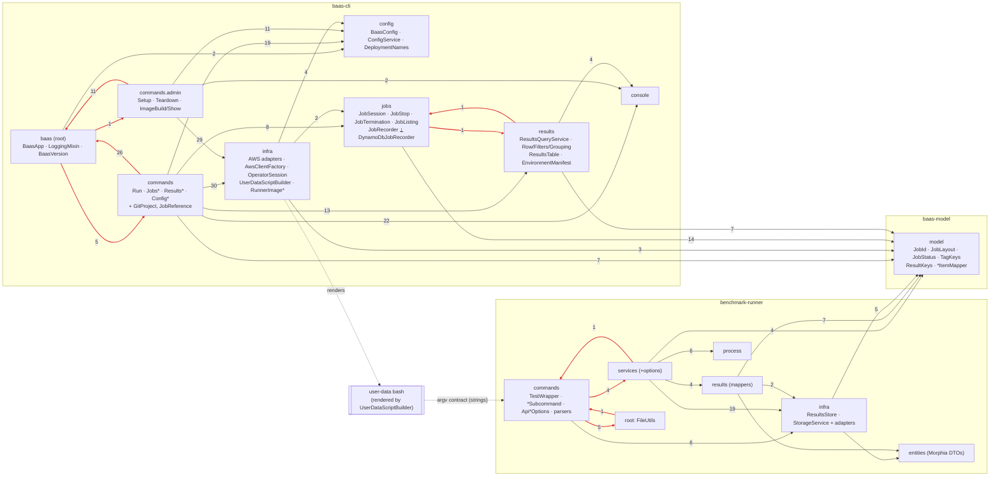

# Architecture review: current state (branch `codebase-review`, 2026-10-13)

Scope: `baas-cli`, `benchmark-runner`, `baas-model`, and the generated user-data shell. The review was read-only.
The dependency data comes from a throwaway script that parses every `import pl.wsztajerowski…` in
`src/main/java` and maps it to its package. Same-package
references need no import, so they are not counted, and only cross-package edges appear. Findings use
the prefix **B**. They avoid re-filing what `docs/review/open-findings.md` already holds (A4, A13, C4, S7,
N3, …) and what ADR 0005 declined (A1, the template method for the four runner services; U15, the
locale of the table).

---

## Summary

1. The CLI has a working **domain core for the job lifecycle**, built on ports (`JobSession`, `JobStop`, `JobTermination` over `JobRecorder` and `JobSession.Instances`). The runner has the same shape (`*SubcommandService` over `ResultsStore` and `StorageService`). Everything around those two cores is organised by technology, not by layer.
2. **The command classes are the application layer.** `RunCommand` (927 lines), `SetupCommand` (627) and `TeardownCommand` (261) mix picocli parsing, use-case orchestration, domain rules (tag policy, watchdog bound, naming) and SDK client lifecycle. That is why `RunCommand.call()`'s success path has no JVM test.
3. Three package cycles exist in the CLI: root↔commands↔admin, through the static `BaasApp.configService(spec)` locator and `LoggingMixin`. jobs↔results is the other. The runner has one cycle of six packages.
4. **The three runtime components share less than CLAUDE.md implies.** `baas-model` owns keys, status and the job prefix. It does not own the artifact names inside the prefix, the job-item write the shell performs, the runner's argv, or the benchmark-type names. Each of these is spelled independently in Java and bash, with no in-process test across them.
5. AWS access has no composition seam. Each command builds concrete adapters from `AwsClientFactory`. Tests work around this by subclassing commands or faking SDK client interfaces. Deployer credentials have no `OperatorSession` counterpart, so four copies of the setup exist.

---

## Current architecture

### Modules

| Module | Main code | Depends on | Notes |
|---|---|---|---|
| `baas-model` | 13 classes, 897 lines, one package `pl.wsztajerowski.baas.model` | `software.amazon.awssdk:dynamodb` (compile) | The enforcer `bannedDependencies` bans `org.mongodb:*` and `dev.morphia*` (`baas-model/pom.xml:44-51`). It holds pure contracts (`JobId`, `JobLayout`, `JobStatus`, `TagKeys`, `StoredMeasurement`, `JobItem`) **and** their DynamoDB encoding (`ResultKeys`, `MeasurementItemMapper`, `JobItemMapper`). |
| `baas-cli` | 67 classes, 10.8k lines | `baas-model`, the SDK (ec2, ssm, cloudformation, s3, sts, iam, imagebuilder, dynamodb), picocli, jackson-yaml, slf4j | It also ships `cf-template-core.yaml`, `deployer-policy.json` and `runner-image.yaml` as classpath resources (`baas-cli/pom.xml:111-118`). It **generates the third component**, the user-data shell. |
| `benchmark-runner` | 53 classes, 3.1k lines, packages `pl.wsztajerowski.*` | `baas-model`, s3, dynamodb, mongodb-driver, morphia, gson, jsoup, picocli | It has no compile dependency on the CLI and the CLI has none on it. Their contract is argv plus the S3 and DynamoDB shapes. |
| user-data (bash) | `UserDataScriptBuilder.SCRIPT_BODY`, about 300 lines of bash in a Java text block | the AWS CLI on the AMI, IMDSv2 | It writes `environment.json`, `packages.txt` and `cloud-init-output.log`, writes job-item status itself, and invokes the runner. It is a component with its own contract that lives inside a CLI `infra` class. |

### What each CLI package actually owns

| Package | Classes | Owns |
|---|---|---|
| `baas` (root) | `BaasApp`, `LoggingMixin`, `BaasVersion` | The picocli root and command map. It is the **composition root and also a service locator**: `BaasApp.configService(spec)` and `deployment(spec)` (`BaasApp.java:99-118`) are called statically by every command. It also owns failure reporting and the `-v` pre-scan. |
| `commands` | 16 classes: `RunCommand`, `Jobs*Subcommand`, `ResultsQuerySubcommand`, `Config*Subcommand`, `GitProject`, `JobReference` | Option parsing, payload rendering (JSON, CSV, tables), **and** each use case's orchestration. `GitProject` (a git subprocess) and `JobReference` (a job-id regex) are infrastructure and domain code that ended up here. |
| `commands.admin` | 7 classes: `SetupCommand`, `TeardownCommand`, `ImageBuildSubcommand`, `ImageShowSubcommand`, noun classes | Deployer use cases, orchestrated inline over `infra` adapters and some raw SDK calls. |
| `config` | `BaasConfig`, `ConfigService`, `DeploymentNames`, `DeploymentNameRule`, `DeploymentSelectionException` | Persistence of `~/.baas/deployments/*.yaml` and the deployment-selection policy. `DeploymentNames` composes resource names. `BaasConfig` is also the in-memory "deployment" every use case receives. |
| `console` | `Console`, `Table`, `StatusLine`, `Watch`, `Hints` | Presentation only. This package is clean, with no outgoing project dependencies. |
| `infra` | 18 classes | AWS adapters (`CloudFormationService`, `Ec2ProvisioningService`, `ImageBuilderService`, `S3UploadService`, `SsmService`, `ParentImageResolver`, `BucketProbe`, `DeployerPreflight`), the client factory (`AwsClientFactory`), session and credential policy (`OperatorSession`), renderers (`UserDataScriptBuilder`, `RunnerImageRenderer`, `DeployerPolicyRenderer`), runner-image domain logic (`RunnerImageDefinition`, `RunnerImageParameters`, `RunnerImageExtension`, `RunnerImage`), and `RunnerJarResolver` (S3 plus GitHub HTTP). |
| `jobs` | `JobSession`, `JobStop`, `JobTermination`, `JobListing`, `JobRecorder`, `DynamoDbJobRecorder` | The job-lifecycle domain plus its port, **and** the DynamoDB adapter for that port. |
| `results` | `ResultsQueryService`, `ResultRow`, `ResultsFilters`, `ResultsGrouping`, `ResultsTable`, `EnvironmentManifest`, `PackagesDiff` | The DynamoDB query adapter, pure row logic, table presentation, and the job-environment manifest and diff (used only by `jobs show` and `jobs diff`). |

### What each runner package owns

| Package | Owns |
|---|---|
| `commands` | `TestWrapper` (the root), four subcommands that act as **composition roots** (they wire storage and store into a service through builders, e.g. `JCStressSubcommand.java:29-36`), and the `Api*Options` picocli mixins. These also build the results store (`ApiCommonSharedOptions.java:126`) and mint the job id and instant when they are absent (`:73`, `:97`). The package also holds the HTML result parsers (`HtmlParser`, `JCStressHtmlResultParser`). |
| `services`, `services.options` | One service per benchmark type: process, upload, then store. The options records are the application-level inputs. |
| `results` | Mapping a parsed result to `StoredMeasurement` (`JmhMeasurementMapper`, `JCStressMeasurementMapper`). `JmhRunResults` also uploads `jmh-result.json` (`JmhRunResults.java:42-44`). |
| `infra` | The ports `ResultsStore` and `StorageService`, their adapters (DynamoDB, Mongo, S3, Local), their builders, and `ResultLoaderService` (gson parsing). |
| `entities`, `entities.jmh`, `entities.jcstress` | Parse DTOs (`JmhResult`, `Metric`, `JCStressResult`), all Morphia `@Entity`, plus `MongoMeasurementDocument`. |
| `process` | `ProcessBuilder` wrappers. |
| root | `FileUtils` (the working directory, derived from where `TestWrapper`'s JAR lives) and `JavaWonderlandException`. |

### Component diagram: real package dependencies

The numbers on the edges are import counts. Red edges are part of a cycle.

### How AWS clients are created and passed

- **The factory.** `AwsClientFactory` (`infra/AwsClientFactory.java:27-111`) memoises the region and credentials and builds a **new SDK client per call** (`ec2()`, `s3()`, `dynamoDb(Duration)`, …). There is no container, no `IFactory` and no interfaces over the adapters.
- **Operator path.** Each operator command holds a lazy `OperatorSession session()` field built from `OperatorSession.of(BaasApp.configService(spec))`. The idiom is copied into 6 commands: `RunCommand.java:94-99`, `JobsTerminateSubcommand.java:43-48`, `JobsListSubcommand.java:69-74`, and Show, Diff, Download and ResultsQuery. `OperatorSession` resolves the deployment (file, or operator-role session), the region (file, or a `BucketProbe` lookup) and credentials (as-is, refused, or `AssumeRole`), then returns a deferred `AwsClientFactory` (`OperatorSession.java:120ish factory()`). Its STS and S3 needs go through a small `OperatorSession.Aws` port with a `REAL` implementation (`:233-263`). This is the best-factored part of the wiring.
- **Deployer path.** No counterpart exists. `new AwsClientFactory(region, AwsClientFactory.profile(config.getAws().getDeployerProfile()))` is repeated in `SetupCommand.java:134`, `TeardownCommand.java:80`, `ImageBuildSubcommand.java:109` and `ImageShowSubcommand.java:53`, and each resolves the region in its own way.
- **Adapters.** Commands then `try (var cf = factory.cloudFormation()) { new CloudFormationService(cf)… }`, so the command owns the client lifecycle. Counts of `factory.*()` calls per command: Run 11, Setup 6, Teardown 5, ImageBuild 4, JobsTerminate 3, JobsShow 3. `RunCommand` deliberately never closes the session's clients because the shutdown hook may still use them (`RunCommand.java:429-435`).
- **Runner.** Static builder factories (`StorageServiceBuilder.getS3ServiceBuilder()`, `ResultsStoreBuilder.builder()`, `ResultLoaderService.getResultLoaderService()`, `JCStressHtmlResultParser.getJCStressHtmlResultParser()`) are called from the subcommand, which injects the resulting ports into the service through its builder.

### How deployment configuration flows into commands

`--deployment` (inherited on `BaasApp`) feeds `BaasApp.configService(spec)`, which creates a `ConfigService(root, named)`. Admin commands then call `ConfigService.load()`, `loadForSetup()` or `loadForSync()` themselves. Operator commands call `OperatorSession.config()`, which may build a fileless `BaasConfig` from the operator-role ARN. Either way the result is a **mutable `BaasConfig` Jackson bean**, passed to every use case as "the deployment". Its derived names (`bucket()`, `resultsTable()`, `stackName()`, `BaasConfig.java:67-78`) delegate to `DeploymentNames`. Runner networking comes from stack outputs on every job (`RunCommand.resolveNetworking`, `:184-203`), never from the file.

### How the CLI and the runner share contracts

| Contract | Owner | CLI use | Runner use | Shell use |
|---|---|---|---|---|
| Measurement item, keys, GSI | `MeasurementItemMapper`, `ResultKeys` | `ResultsQueryService` | `DynamoDbResultsStore`, `MongoResultsStore` | none |
| Job item | `JobItemMapper`, `ResultKeys.jobSortKey`, `JobStatus` | `DynamoDbJobRecorder` | none | **Hand-written** `update-item` JSON (`UserDataScriptBuilder.java:44-58`). Only the sort key and the guard expression come from Java. |
| Job prefix | `JobLayout.jobPrefix` | `RunCommand.java:381` | Default only, when `--result-path` is absent (`ApiCommonSharedOptions`) | Receives `RESULT_PATH` |
| Artifact names inside the prefix | **nobody** | literals | literals | literals (B3) |
| Tag vocabulary | `TagKeys` | `RunCommand.buildRunnerTags` | `getProject` reads `TagKeys.PROJECT` | Observed keys as literals (`UserDataScriptBuilder.java:269-274`) |
| Runner argv, flag names and type names | **nobody** | `UserDataScriptBuilder.java:261-276`, `RunCommand.java:85` | picocli annotations | renders them (B4) |
| Manifest schema | `UserDataScriptBuilder.MANIFEST_SCHEMA_VERSION` (writer); `EnvironmentManifest.GROUPS` (reader) | both in the CLI | none | heredoc |
| Version lockstep | `BaasVersion`, `JobLayout.runnerJarKey` | pins `releases/<cliVersion>/` | none | downloads it |

---

## Dependency matrix and cycles

Rows import columns, by import count. `.` means none. Self-edges are omitted.

### CLI and model

| from \ to | root | commands | admin | config | console | infra | jobs | results | model |
|---|---|---|---|---|---|---|---|---|---|
| **root** | . | 5 | 1 | 2 | . | . | . | . | . |
| **commands** | **26** | . | . | 19 | 22 | 30 | 8 | 13 | 7 |
| **admin** | **11** | . | . | 11 | 2 | 29 | . | . | . |
| **config** | . | . | . | . | . | . | . | . | . |
| **console** | . | . | . | . | . | . | . | . | . |
| **infra** | . | . | . | 4 | . | . | 2 | . | 3 |
| **jobs** | . | . | . | . | . | . | . | **1** | 14 |
| **results** | . | . | . | . | 4 | . | **1** | . | 7 |
| **model** | . | . | . | . | . | . | . | . | . |

SDK imports by package: `infra` imports cloudformation, dynamodb, ec2, iam, imagebuilder, s3, ssm, sts. `jobs` and `results` import dynamodb. `commands.admin` imports cloudformation and dynamodb (`SetupCommand.java:25-27`). `commands` imports `AwsServiceException` (`RunCommand.java:39`). `model` imports dynamodb.

### Runner

| from \ to | commands | entities | ent.jcstress | ent.jmh | infra | root | process | results | services | options | model |
|---|---|---|---|---|---|---|---|---|---|---|---|
| **commands** | . | . | 3 | . | 6 | **5** | . | . | **4** | 5 | 3 |
| **entities** | . | . | . | . | . | . | . | . | . | . | 1 |
| **infra** | . | 1 | . | 1 | . | **2** | . | . | . | 1 | 5 |
| **root** | **1** | . | . | . | . | . | . | . | . | . | . |
| **process** | . | . | . | . | . | **1** | . | . | . | 1 | . |
| **results** | . | . | 1 | 2 | **2** | . | . | . | . | 1 | 7 |
| **services** | **1** | . | 1 | 2 | 19 | 4 | 6 | 4 | . | 18 | 4 |

### Strongly connected components (cycles)

1. **CLI `{baas, commands, commands.admin}`.** Every command imports `LoggingMixin` and calls `BaasApp.configService(spec)` (26 plus 11 imports), while `BaasApp` imports every noun to register it. Evidence: `BaasApp.java:13-18` against `RunCommand.java:12-14` and `SetupCommand` (`BaasApp`, `LoggingMixin`).
2. **CLI `{jobs, results}`.** `JobListing` uses `ResultsFilters::pair` (`JobListing.java:5,61`). `ResultsQueryService.resultPathForJob` creates a `DynamoDbJobRecorder` (`ResultsQueryService.java:6,197`).
3. **Runner `{commands, services, infra, results, process, root}`.** `JCStressSubcommandService.java:20` imports `commands.JCStressHtmlResultParser`. `FileUtils.java:3,10` imports `commands.TestWrapper`. The `commands` package imports `FileUtils` and `JavaWonderlandException` from the root, and `infra` and `process` also import the root. `results` imports `infra` (`StorageService`, `ResultLoaderService`).

`baas-model` and `console` are leaves, as they should be. `config` is a leaf as well.

---

## Layer map

Layers: **P** is presentation (picocli, rendering, `Console`). **A** is application or use-case orchestration. **D** is domain rules. **I** is an infrastructure adapter (SDK, process, HTTP, filesystem). A row with more than one letter means **mixed in one class**.

| Class or package | Layers occupied | Where the mixing is |
|---|---|---|
| `BaasApp` | P + composition root + **service locator** | `configService(spec)` and `deployment(spec)` are static lookups into the picocli root (`:99-118`) |
| `RunCommand` | **P + A + D + I** | P: options, JSON summary (`:907-922`), hints, status line. A: `execute()` (`:287-486`). D: tag policy (`:816-859`), `watchdogBound` (`:756`), project name (`:731`), `VALID_TYPES` (`:85`). I: client lifecycle, `AwsServiceException` parsing (`:553`), stack-output keys (`:190`), launch-error report (`:563-579`) |
| `SetupCommand` | **P + A + D + I** | Raw `sts.getCallerIdentity()` (`:139`), `DynamoDbClient.describeTable` (`:415`), `StackStatus` (`:306-309`), the default-name rule `computePrefix` (`:620`), `+ "-results"` (`:317`, `:389`) |
| `TeardownCommand`, `ImageBuildSubcommand`, `ImageShowSubcommand` | P + A + I | They orchestrate the CF, Image Builder, EC2 and SSM adapters inline |
| `Jobs{List,Show,Diff,Download,Terminate}Subcommand` | P + A (+I wiring) | Thin. `JobsShowSubcommand.Sources` is a command-local port (`:77-111`). `JobsDiffSubcommand` builds S3 keys by hand (`:125`, `:199`) |
| `ResultsQuerySubcommand` | P + A | It holds the JSON, CSV and table writers, the picker, the watch loop, and the filter pipeline. The shared `jsonString` and `csvField` are used by four other commands |
| `Config*Subcommand` | P + A | `ConfigSync` mutates the config, sets the region to null, then restores it (`ConfigSyncSubcommand.java:70-90`) |
| `commands.GitProject` | I | A git `ProcessBuilder` inside the commands package |
| `commands.JobReference` | D | It re-encodes the `JobId` format as a regex (`:14`) |
| `config.BaasConfig` | persistence DTO + D | Names (`:67-78`) and region resolution from env (`:155-163`) live on a mutable Jackson bean |
| `config.ConfigService` | I (filesystem) + A (selection policy) | Acceptable. The policy text sits next to the I/O |
| `config.DeploymentNames`, `DeploymentNameRule` | D | Clean |
| `console.*` | P | Clean |
| `infra.OperatorSession` | A + I | Deployment selection and credential policy over the `Aws` port, with `REAL` in the same class. A good seam |
| `infra.AwsClientFactory` | I | Clean |
| `infra.{CloudFormation,Ec2Provisioning,ImageBuilder,S3Upload,Ssm}Service` | I | Concrete classes over SDK clients. `CloudFormationService.stackStatus` returns SDK `StackStatus` (`:282`). `S3UploadService` also downloads, lists and deletes (it is misnamed). `Ec2ProvisioningService` implements `JobSession.Instances` (the infra→jobs edge) |
| `infra.UserDataScriptBuilder` | **third component**, D (contract) | It is a bash program. It imports `jobs.DynamoDbJobRecorder` for the guard (`:5`, `:335`, `:348-353`) |
| `infra.RunnerImage{Definition,Parameters,Extension}` | D | Image versioning and extension rules, placed in `infra` |
| `infra.RunnerImageRenderer`, `DeployerPolicyRenderer` | D (rendering) | Pure apart from classpath reads |
| `infra.DeployerPreflight`, `BucketProbe`, `ParentImageResolver` | I (+D for policy probing) | `BucketProbe` is a sealed result type with an injected client function. A good seam |
| `infra.RunnerJarResolver` | I + D (integrity) | Static methods over `S3Client` and a static `HttpClient` |
| `jobs.JobSession`, `JobStop`, `JobTermination`, `JobListing` | D + A | Port-based, with clock and sleeper injected. EC2 state strings leak in (B13) |
| `jobs.JobRecorder` | port | Clean |
| `jobs.DynamoDbJobRecorder` | I | An adapter that sits in a domain package and also hosts a cross-component contract (`NOT_TERMINAL`) |
| `results.ResultsQueryService` | I | Owns the client (`close()`), re-declares attribute names (`:46-48`), and calls the job adapter |
| `results.ResultRow`, `ResultsFilters`, `ResultsGrouping` | D | Clean |
| `results.ResultsTable` | P | Lives in `results` (the results→console edge) |
| `results.EnvironmentManifest`, `PackagesDiff` | D | They describe the job environment but sit in `results` |
| `baas-model` mappers | I (DynamoDB encoding) | Shared on purpose. Pure contracts share the package |
| runner `commands.*Subcommand` | P + composition root | Clean |
| runner `commands.ApiCommonSharedOptions` | P + factory + D | `buildResultsStore()` (`:126`), id and instant minting (`:73`, `:97`), project precedence (`:107`) |
| runner `commands.JCStressHtmlResultParser`, `HtmlParser` | I (parsing) | In the presentation package |
| runner `services.*Service` | A | Clean, over ports. A1 was declined in ADR 0005 |
| runner `results.JmhRunResults` | A + I | Upload side effect inside "map" (`:42-44`) |
| runner `infra.*` | port + I | The ports live with their adapters |
| runner `entities.jmh`, `entities.jcstress` | DTO with Morphia annotations | The DynamoDB path's parse types carry `@Entity` (`JmhResult.java:9`) |

---

## Findings

### B1: The `baas run` use case lives inside `RunCommand`, so the main path cannot be tested · Should · M

- **Location:** `baas-cli/.../commands/RunCommand.java:287-486` (`execute`), `:548-638`, `:688-696`.
- **Evidence:** One 200-line method runs these steps in order:
  1. resolve the project and the table;
  2. validate tags;
  3. look up the image (`ImageBuilderService`, built from three raw clients at `:350-352`);
  4. read the networking outputs;
  5. name the job;
  6. upload, or seed the pinned runner;
  7. render user-data;
  8. wire `JobSession` to two `DynamoDbJobRecorder`s and `Ec2ProvisioningService`;
  9. reserve, register the hook, launch, confirm, poll, and report.

  Each step constructs its own adapter from `AwsClientFactory`. The only seams are package-private helpers (`buildRunnerTags`, `afterLaunch`, `reportJobResults`, `resolveTimings`). CLAUDE.md states the gap itself: "`RunCommand.call()`'s success path is executed by no JVM test". The 73 tests in `RunCommandTest`, `RunCommandDetachTest` and `RunCommandSummaryTest` cover the helpers and the failure paths that end before AWS.
- **Recommendation:** Extract a `JobLaunch` (or `RunJob`) use case into `jobs`. It should take a `RunRequest` value (type, params, project, tags, timings, JARs) and narrow ports for the image catalogue, stack networking, artifact store, runner-JAR source, `JobRecorder` and `Instances`. It should return a `RunReport` that `RunCommand` renders. Keep the shutdown-hook ownership in the command, or in a small `JobGuard`, because the hook is a process concern. `JobSession` already provides the hard part, so this is mostly moving code. It is the single change that most improves "clearer boundaries".

### B2: The job-item write has three encodings, and the shared guard sits in an adapter · Should · S

- **Location:** `UserDataScriptBuilder.java:5`, `:44-58`, `:335-336`, `:348-353`; `jobs/DynamoDbJobRecorder.java:38-56`; `baas-model/.../JobItemMapper.java:17-26`.
- **Evidence:** The shell's `job_status` hard-codes `"pk"`, `"sk"`, `"JOB"`, `"status"` and `"instanceId"` (`:49`, `:53`, `:58`). The same names are constants in `JobItemMapper` and `ResultKeys.JOB_PARTITION_KEY`. Only the sort key and the `NOT_TERMINAL` guard are handed down from Java, and the guard is defined in the CLI's DynamoDB adapter, which creates the infra→jobs edge. Renaming an attribute in `JobItemMapper` would compile and pass the unit tests. The instance's `running` write would then be refused (the `attribute_exists(pk)` path), and the instance would ship its log and terminate without running the benchmark. Only the paid E2E would catch that.
- **Recommendation:** Move `NOT_TERMINAL` and `NOT_TERMINAL_VALUES` into `baas-model` (`JobItemMapper` or a `JobItemConditions`). Render the shell's attribute names, key JSON and partition value from those constants through `export`. Add a unit test that captures the rendered `--key`, `--update-expression` and `--expression-attribute-*` arguments and asserts they address the item `JobItemMapper.key(job)` builds.

### B3: `JobLayout` owns the job prefix but not the artifact names inside it · Should · S

- **Location:**
  - shell: `UserDataScriptBuilder.java:90`, `:107`, `:228-229`, `:285`
  - CLI readers: `JobsShowSubcommand.java:103`, `JobsDiffSubcommand.java:125-126`, `:199`, `RunCommand.java:585`
  - runner: `JmhRunResults.java:42`, `:46`; `JCStressSubcommandService.java:75`, `:112`; `JmhSubcommandService.java:46`; `JmhWith*Service.java:60/62`; `JobLogs.java:46`
- **Evidence:** CLAUDE.md says "one job is one prefix … built only by `JobLayout`/`JobId` … a hand-built prefix … presents as an empty download rather than as an error". In practice `environment.json`, `packages.txt`, `cloud-init-output.log`, `jmh-result.json`, `*-output.txt` and `logs/` are spelled separately by three writers and three readers. Readers also normalise a trailing `/` separately (`JobReference.java:42`, `JobsShowSubcommand.java:242-244`). The runner builds S3 keys with `java.nio.file.Path.resolve(...).toString()`, which depends on the OS path separator.
- **Recommendation:** Add the leaf names to `JobLayout` (`environmentKey`, `packagesKey`, `bootLogKey`, `resultJsonKey`, `processOutputKey(type)`, `logsPrefix`). Export the shell's names from Java. Make the runner build keys as strings through `JobLayout`, not `Path`. This also gives `jobs download` and `jobs show` one definition of "the job's files".

### B4: The CLI→runner argv contract is untyped, and one rule is encoded twice with different behaviour · Should · S

- **Location:** `UserDataScriptBuilder.java:261-276`; `benchmark-runner/.../ApiCommonSharedOptions.java:23-61`, `:107-121`; `RunCommand.java:85`, `:827-832`; the runner's `@Command(name=…)` in four subcommands.
- **Evidence:** Flag names (`--job-id`, `--created-at`, `--result-path`, `--s3-bucket`, `--benchmark-path`, `--results-table`, `--tag`) and the type names (`jmh`, `jmh-with-async`, `jmh-with-prof`, `jcstress`) are literals on both sides. The shell writes the observed tag keys as literals (`imageVersion=`, `cpuArch=`, …), and `TagKeys` is imported but unused there (`:4`). `baas-cli`'s test classpath has no `benchmark-runner`, so no in-process test parses a rendered argv with `TestWrapper`. `observedTagValueWinsOverACollidingCallerTagUnderPicocliParsing` uses a stand-in option, not the real one. On project: the CLI rejects `--tag project` and sends the project **only** as a tag, never `--project`. The runner accepts both, `--project` wins (`ApiCommonSharedOptions.java:107-121`), and it mints its own job id and instant when they are absent (`:73-76`, `:97-99`). The "one input for project" and "one instant" invariants therefore hold only because the CLI happens to call the runner a particular way.
- **Recommendation:** Put a `RunnerArgs` contract class in `baas-model`, holding flag names as `public static final String` (usable in picocli annotations) and a `BenchmarkType` enum. Use it in `UserDataScriptBuilder`, `RunCommand` and the runner annotations. Add a test in `benchmark-runner` that feeds the argv `UserDataScriptBuilder` would render (a fixture string, or a tiny shared renderer in the model) through `new CommandLine(new TestWrapper()).parseArgs(...)`. Decide whether the runner should also reject `--project` that disagrees with `--tag project`.

### B5: Package cycles in the CLI · Should · S

- **Location:** `BaasApp.java:13-18`, `:99-118`; `LoggingMixin` used by every command; `jobs/JobListing.java:5`, `:61`; `results/ResultsQueryService.java:6`, `:196-215`.
- **Evidence:** See *Dependency matrix and cycles*, items 1 and 2. The root cycle exists because the composition root also serves as a static registry. The jobs↔results cycle comes from one helper (`ResultsFilters.pair`) and one convenience (`resultPathForJob` building a job recorder).
- **Recommendation:** Move `LoggingMixin` and the spec→`ConfigService` resolution into a `baas.cli` support package that commands depend on, and keep `BaasApp` importing commands only. Better still, inject a per-invocation context through a picocli `IFactory` or an inherited mixin (see B6). Move tag-pair parsing next to `TagKeys` (in the model) or into a small `tags` package. Have `jobs download` call `JobRecorder.find` and fall back to the measurement index explicitly, instead of `results` constructing a `jobs` adapter. Add a dependency rule test (plain JUnit over the imports, or ArchUnit) so the cycles cannot return.

### B6: AWS access has no composition seam, and deployer credentials are wired in four places · Should · M

- **Location:** `SetupCommand.java:134`, `TeardownCommand.java:80`, `ImageBuildSubcommand.java:109`, `ImageShowSubcommand.java:53`; the lazy `session()` idiom in 6 commands; `private Console console()` in 8 commands; `factory.*()` call counts as listed above.
- **Evidence:** Adapters are concrete classes constructed inside `call()` from SDK clients that the command opens and closes. Tests reach behind this in two ways:
  - six anonymous subclasses override package-private hooks: `ResultsQueryPipelineTest:70`, `JobsShowCommandTest:52`, `JobsDiffCommandTest:65`, `ConfigSyncSubcommandTest:196`, `ResultsProjectSelectionTest:166`, `TeardownConfigFileTest:61`;
  - `FakeEc2`, `FakeSsm` and `FakeImageBuilder` implement the SDK client interfaces.

  The operator path has `OperatorSession`. The deployer path has no equivalent, so its credential and region rules (default chain, `resolveRegion()` with or without env) can drift per command.
- **Recommendation:** Add a `DeployerSession` that mirrors `OperatorSession`. Then give commands one injected `Deployment` context, with a test double, that exposes **ports** instead of the factory: `JobRecorder`, `Instances`, `ArtifactStore` (S3 get, put, list), `StackInfo` (outputs, parameters, status as a project enum), `ImageCatalog`, `ResultsReader`. `AwsClientFactory` and the concrete services stay underneath unchanged. Command tests can then use in-memory ports instead of subclassing commands or implementing SDK interfaces. `JobsShowSubcommand.Sources` (`:77-111`) is already this pattern at command scope.

### B7: The persistence DTO `BaasConfig` is the deployment context · Should · S

- **Location:** `config/BaasConfig.java:28-78`, `:155-163`; `infra/OperatorSession.java` (`config()` builds a fileless `BaasConfig` with `setPrefix`); `SetupCommand.java:120-124`, `:138`; `ConfigSyncSubcommand.java:70-90`.
- **Evidence:** A mutable Jackson bean with `@JsonIgnore` prefix, `NON_NULL` sections and `EmptySection` filters is passed to every use case. Commands mutate it in place before saving: setup sets the region and prefix, and sync nulls the region and then restores it. Name derivation and env-based region resolution sit on the same object. The file format is therefore part of every application signature, and "what is persisted" versus "what was resolved for this invocation" is decided by which setter ran last.
- **Recommendation:** Split it into `DeploymentFile` (the DTO, owned by `ConfigService`) and an immutable `Deployment(name, region, DeploymentNames, Preferences, credentialSources)`, resolved once by the session. Writes go through explicit `ConfigService` operations (`adopt`, `setPreference`).

### B8: The naming and stack-contract literals bypass `DeploymentNames` · Could · XS

- **Location:** `SetupCommand.java:317` and `:389` (`prefix + "-results"`), `:620-626` (`computePrefix`, the default-name rule); stack keys `RunCommand.java:190`, `:468`, `SetupCommand.java:301`, `:364`, `ImageBuildSubcommand.java:162`.
- **Evidence:** CLAUDE.md says "only `DeploymentNames` composes them (C5)". Two call sites in setup compose a name themselves. Stack output and parameter names are bare strings, whereas the image parameters already have a constants class (`RunnerImageParameters.java:26-32`) that `CoreTemplateTest` can pin.
- **Recommendation:** Use `DeploymentNames.of(prefix).resultsTable()`. Move `computePrefix` to `DeploymentNames.defaultFor(accountId)`. Add a `CoreStack` constants class (`OUTPUT_SUBNET_ID`, `OUTPUT_SECURITY_GROUP_ID`, `OUTPUT_OPERATOR_ROLE_ARN`, `PARAM_RESOURCE_NAME_PREFIX`, …) and a template test asserting each one is declared.

### B9: Packages are organised by technology, and each hides more than one layer · Could · S

- **Location:** `results` (adapter, domain, presentation, and the environment manifest), `jobs` (domain and adapter), `infra` (adapters, renderers, image-domain rules, session policy), `commands` (`GitProject`, `JobReference`).
- **Evidence:** See the layer map. `EnvironmentManifest` and `PackagesDiff` are used only by `jobs show` and `jobs diff`. `JobReference.JOB_ID` (`:14`) duplicates `JobId`'s format, even though CLAUDE.md says "nothing parses it". `RunnerImageParameters.plan` (version bumping) is domain logic in `infra`.
- **Recommendation:** Slice by feature, then by layer: `jobs.{domain, port, aws}`, `results.{domain, aws, view}`, `image.{domain, aws, render}`, `deployment.{session, config, aws}`, `cli` (commands plus console). Move the environment types under `jobs`. Add `JobId.looksValid(String)` in the model. This is the target shape that B1, B5 and B6 make cheap to reach.

### B10: Payload encoders are duplicated, and one diverges · Could · S

- **Location:** `RunCommand.java:917-922` (escapes only `\` and `"`); `ResultsQuerySubcommand.java:436-495` (full escaping, `Locale.ROOT`); `JobsListSubcommand.java:254`, `:268`, `:274`, `:277-279`; `JobsShowSubcommand.java:250`; `ConfigListSubcommand.java:98`; `JobsTerminateSubcommand.java:67` uses `RunCommand.STOP_WRITE_TIMEOUT`.
- **Evidence:** Four commands borrow static helpers from `ResultsQuerySubcommand` or `RunCommand`, so commands depend on other commands. `RunCommand`'s own `jsonString` would emit invalid JSON for a control character. Jackson is already on the classpath (`jackson-dataformat-yaml`).
- **Recommendation:** Add `console.Json` and `console.Csv` payload writers (or Jackson with `Locale.ROOT`-safe number handling), plus a `formatElapsed` in `console`. Move `STOP_WRITE_TIMEOUT` to `JobStop`.

### B11: Runner package cycle, and parsing and upload placed in the wrong layer · Could · S

- **Location:** `services/JCStressSubcommandService.java:20` (imports a `commands` parser); `FileUtils.java:3`, `:10` (imports `TestWrapper`); `results/JmhRunResults.java:37-44` (uploads inside mapping); `entities/jmh/JmhResult.java:9`, `entities/jmh/Metric.java:9`, `entities/jcstress/JCStressResult.java:8` (Morphia `@Entity` on parse DTOs).
- **Evidence:** See the dependency matrix. The JSON and HTML parse DTOs used by the DynamoDB path carry Morphia annotations.
- **Recommendation:** Move `HtmlParser` and `JCStressHtmlResultParser` next to `ResultLoaderService` in a `parsing` package. Have `FileUtils` take its anchor class as a parameter, or live in `commands`. Split `JmhRunResults` into "upload the verbatim JSON" (service) and "map" (pure). Add "strip `@Entity` from the parse DTOs" to the scope of **C4 `retire-mongodb`**. This is not a new finding; it is a dependency C4 has not listed yet.

### B12: The C4 and sequence diagrams have drifted from the code · Could · XS

- **Location and evidence:**
  - `docs/diagrams/c4-3-component-cli.mmd` names `BuildImageCommand`, `ImageCommand`, `DeployerPolicyCommand`, `DownloadCommand`, `EnvDiffSubcommand` and `ResultsTableService`. None of these exist. It omits `OperatorSession`, `AwsClientFactory`, `ConfigListSubcommand`, `JobsShowSubcommand`, `JobsDiffSubcommand` and `GitProject`.
  - `c4-2-container.mmd` says the deployment file holds the "prefix". It is `@JsonIgnore` (`BaasConfig.java:35`).
  - `baas-build-image.mmd:3` has participant `BuildImageCommand`. The class is `ImageBuildSubcommand`.
  - `baas-run.mmd:11` still lists `[--config-path]`, which was removed. It places `buildRunnerTags` after the uploads and `describeStacks` after naming the job; the code does both earlier (`RunCommand.java:329`, `:373`). Its reserved-key list lacks `jvmVendor`, and its JSON summary lacks `jobStatus`.
  - The runner C4 shows `PutItem`, but the code uses `BatchWriteItem`.
- **Recommendation:** Regenerate the CLI component view from the actual packages; the diagram above can serve as its starting point. Fix `baas-run.mmd` and `baas-build-image.mmd`. Per CLAUDE.md, render each one with `mmdc` and look at it before committing.

### B13: The EC2 state vocabulary leaks into the job domain · Could · XS

- **Location:** `jobs/JobSession.java:28-35`, `:232-233`, `:268-269`; `jobs/JobTermination.java:93`; `JobSession.Outcome.STATUS_LOST` (`:43`).
- **Evidence:** `Instances.state()` returns the raw EC2 state string, or `"unknown"`, and the domain compares it with `"terminated"`, `"shutting-down"`, `"pending"` and `"running"`. The `status-lost` outcome is a status string that `JobStatus` does not define.
- **Recommendation:** Have the port return `enum InstanceLiveness { LIVE, GONE, UNKNOWN }`, so the EC2 mapping stays in `Ec2ProvisioningService`. Define `STATUS_LOST` beside `VANISHED` in `JobStatus` as a read-time-only status.

### B14: `baas-model` mixes pure contracts with DynamoDB encoding, and some vocabulary is outside it · Could · S

- **Location:** `baas-model/pom.xml` (dynamodb at compile scope); `MeasurementItemMapper.java:45` (`TAGS` is package-private); `results/ResultsQueryService.java:46-48` (re-declares `"tags"`, `"project"` and `exclude_from_results`); `DynamoDbJobRecorder.java:125`, `:143` (job keys through `MeasurementItemMapper.PK`, `GSI1PK`).
- **Evidence:** The enforcer protects the model from Mongo only. Nothing stops a pure type from picking up SDK types. Readers that need an attribute name the mapper keeps private re-declare it. `exclude_from_results` is a query-surface convention that `TagKeys` does not list.
- **Recommendation:** Keep one module, because shared encoding is its purpose. Split the packages into `model` (pure, no SDK) and `model.dynamodb` (mappers, `ResultKeys`, conditions from B2). Make attribute-name constants public in a `TableSchema` class. Add `TagKeys.EXCLUDE_FROM_RESULTS`. Add a test asserting that `model` imports no `software.amazon`.

---

## Testability consequences

- **What is well tested:** pure and port-based code. That covers `JobSession`, `JobStop`, `JobTermination` and `JobListing` (with clock, sleeper and fake recorders and instances), `ResultsFilters` and `ResultsGrouping`, `EnvironmentManifest`, `DeploymentNames`, the renderers, `OperatorSession` (its `Aws` port), and above all `UserDataScriptBuilder`. That last one has more than 70 string and bash-harness tests, including real `bash -n` and executed harnesses (`UserDataScriptBuilderTest.java:72`, `:993`).
- **What resists testing:** anything inside `call()`. `RunCommand`'s attached and detached success paths, `SetupCommand.deploy`, `TeardownCommand.call` and `ImageBuildSubcommand.call` need real AWS, LocalStack (which cannot run CloudFormation, Image Builder or EC2 here), or SDK-interface fakes. That is why the only end-to-end check of `baas run` is the paid `e2e-cloud-test.yml` (B1, B6).
- **Workarounds used:** anonymous command subclasses that override package-private hooks (6 sites), SDK client fakes (`FakeEc2 implements Ec2Client`), and `InfraFixtures`. All of them work, but they couple tests to command internals and SDK request shapes, so a refactor of either breaks the tests without any behaviour change.
- **Cross-component contracts are tested on one side only:** the shell side through string assertions, and the runner side through its own ITs. Nothing joins them in-process (B2, B3, B4), so drift surfaces only in the paid E2E, or as an empty download.
- **Runner:** the services are testable through their ports. Every service IT stores through Mongo, which is already recorded as C4. Static builder getters (`getS3ServiceBuilder()`, `getResultLoaderService()`) are fine at the composition root but stop a subcommand being tested without S3.

---

## Seams that already exist and are good (preserve them)

1. **`JobRecorder` and `JobSession.Instances` ports, with `JobSession`, `JobStop` and `JobTermination` as the single stop path.** Clock and sleeper are injected, and the first-outcome-wins logic is isolated (ADR 0003). Any refactor should move code *towards* this shape.
2. **`OperatorSession` with its `Aws` port, and the deferred `AwsClientFactory`.** Credential and deployment selection is testable without AWS, and the failure modes are explicit. Model `DeployerSession` on it (B6).
3. **`baas-model` as the single owner of keys, mappers, `JobStatus`, `JobLayout`, `JobId` and `TagKeys`,** guarded by the enforcer ban. Extend its reach (B2–B4, B14) rather than splitting the shared encoding into two copies.
4. **The runner's `ResultsStore` and `StorageService` ports,** wired by the subcommand acting as composition root. They also form the seam C4 needs to drop Mongo.
5. **`UserDataScriptBuilder` as a pure function from values to script,** with every value going through `export` or `array`, the guard rendered from the CLI's own expression, and the bash-harness tests. Whatever package it moves to, keep it pure and keep those tests.
6. **`DeploymentNames` and `DeploymentNameRule`,** pinned to the template by `DeploymentNamesTemplateTest`. `RunnerImageParameters` is the stack-parameter contract. `CoreTemplateTest`, `OperatorPolicyDriftTest` and `DeployerPolicyTest` pin the YAML and JSON artifacts to the Java.
7. **`Console` as the only payload sink** (with `Table` and `StatusLine`). The package has no outgoing project dependencies.
8. **`BucketProbe` (a sealed result with an injected client function) and `JobsShowSubcommand.Sources`.** These are small, local ports that show the pattern B6 generalises.
9. **CLI and runner versions in lockstep** (`releases/<cliVersion>/benchmark-runner.jar`, seeded once). The argv contract is always between artifacts from the same release, so a shared contract class in `baas-model` (B4) is sufficient and needs no versioned protocol.
