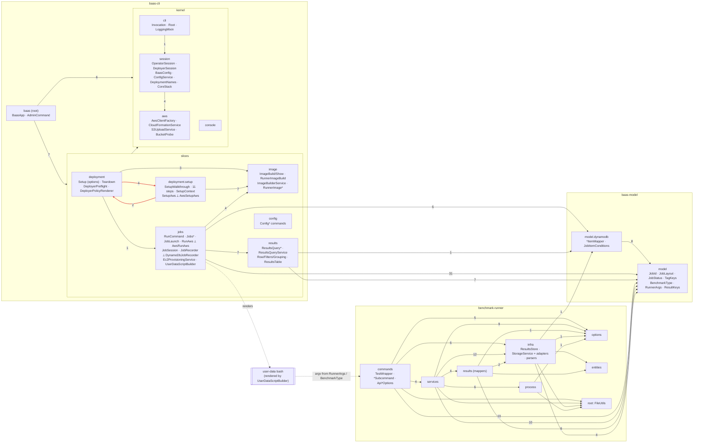

# Architecture review: current state (branch `codebase-review`, 2026-10-13)

Re-checked against slice-architecture (post-refactor) on 2026-10-15.

Re-verified against 7d9660a on 2026-10-14.

Scope: `baas-cli`, `benchmark-runner`, `baas-model`, and the generated user-data shell. The review was read-only.
It was written against `dabbc55`, re-verified against `7d9660a` (which landed `interactive-setup`), and
re-checked on `slice-architecture` after the refactor it recommended: ADR 0009, commits `0308fb8..a8be1a0`
(`78d5f19` model contract, `26cd227` names, `46a9030` payload writers, `e6a6900` `cli.Invocation` and
`DeployerSession`, `93f588c` `JobLaunch` over `RunAws`, `fff4faa`, `ccf955c` the slice layout, `81df090` the
runner cycle, `b6f4717` the implementation-review fixes, `a8be1a0` the simplification review's Z1–Z3, Z5–Z7,
Z10 and Z11). Every `file:line` in the current-state sections and in the open findings is at `a8be1a0`. Where
`d024380` (before the simplification commit) differs, the difference is in import counts only, and it is stated.

The dependency data comes from a throwaway script that parses every `import pl.wsztajerowski…` in
`src/main/java` (static and wildcard imports included) and maps it to its longest matching package. Same-package
references need no import, so they are not counted, and only cross-package edges appear. Findings use
the prefix **B**. They avoid re-filing what `docs/review/open-findings.md` already holds (A4, A13, C4, S7,
N3, …), what ADR 0005 declined (A1, the template method for the four runner services; U15, the
locale of the table), and what the implementation review (`implementation-review.md`, I1–I14) and the
simplification review (`simplification-review.md`, Z1–Z12) file against the refactor itself.

---

## Summary

1. **The CLI is now a composition root, a kernel and five slices by noun** (ADR 0009). `baas` registers
   commands and is imported by nothing. The kernel (`cli`, `console`, `session`, `aws`) imports no slice. The
   slices (`jobs`, `results`, `deployment` with `deployment.setup`, `image`, `config`) import each other only along
   deployment → jobs → {image, results}. `SliceBoundaryTest` enforces all three rules on import lines.
2. **`baas run` follows setup's shape.** `RunCommand` (615 lines, was 938) parses, prints the summary and owns the
   shutdown hook. `JobLaunch` (390) is the use case, over one port, `RunAws`, with `AwsRunAws` in production and
   `FakeRunAws` in tests. The success path now runs in the JVM (`JobLaunchTest`, `RunCommandLaunchTest`).
3. **`baas-model` is the one contract the three runtimes read.** It owns the artifact names, the benchmark types,
   the runner's option names and the job-item guard. It is split into an SDK-free `model` and a `model.dynamodb`
   for the table encoding. User-data takes every shared name through tokens substituted at class load.
4. **Cycles.** The root ↔ commands ↔ admin cycle and jobs ↔ results are gone. The runner is acyclic. One
   package cycle was left, inside one slice, `deployment` ↔ `deployment.setup` (B15); it was fixed in the same branch, so neither module has a package cycle now.
5. **What is still open is the AWS seam for the commands that were not extracted.** Teardown, both image
   commands, the four `jobs` read commands, `results query` and `config sync` still open SDK clients inside
   `call()` (B6). `BaasConfig` is still the mutable deployment object everywhere except `JobLaunch` (B7). The
   runner still uploads inside a mapper and keeps Morphia annotations on parse DTOs (B11). EC2 state strings
   still reach the job domain (B13).

### Re-check status (slice-architecture)

| ID | Status | Note |
|---|---|---|
| B1 | **Fixed by the refactor** | `JobLaunch` over `RunAws`; `RunCommand.call()` runs in `RunCommandLaunchTest` |
| B2 | **Fixed by the refactor** | Guard in `model.dynamodb.JobItemConditions`; user-data's names are tokens from `JobItemMapper`/`MeasurementItemMapper`/`ResultKeys` |
| B3 | **Fixed by the refactor** | Names in `JobLayout`/`BenchmarkType`, every reader and writer uses them. Residue: the runner still joins keys with `Path.resolve` |
| B4 | **Fixed by the refactor** (contract) | `RunnerArgs`, `BenchmarkType`, `RunnerArgsContractTest`. The `--project`-wins rule and PARAMS overriding guarded options remain, as G1 in `api-gaps.md` |
| B5 | **Fixed by the refactor** | No cycle through the root or between slices; `SliceBoundaryTest` holds it. One intra-slice package cycle is B15 |
| B6 | **Open, changed** | `DeployerSession` ends the four hand-built factories; `run` has a port. Nine command classes still build clients inline; six anonymous-subclass tests remain |
| B7 | **Open, changed** | `JobLaunch` takes immutable `DeploymentNames`; every other use case still holds the mutable `BaasConfig` |
| B8 | **Fixed by the refactor** | `CoreStack` constants, `DeploymentNames.defaultFor`, `DeploymentNames.of(…).resultsTable()`; no bare literal left |
| B9 | **Fixed by the refactor** | Slices by noun. Residue: `JobReference.JOB_ID` still re-encodes `JobId`'s format |
| B10 | **Fixed by the refactor** | `console.Json`, `Csv`, `Elapsed`; `STOP_WRITE_TIMEOUT` on `JobSession`; no command borrows another's statics |
| B11 | **Open, changed** | Cycle fixed (runner acyclic); upload inside `JmhRunResults` and `@Entity` on parse DTOs remain |
| B12 | **Open, being fixed in this branch** | Diagrams are being redrawn by another change on `slice-architecture` (also I10); not re-checked here |
| B13 | **Open, relocated** | Unchanged in substance; new lines in `JobSession`/`JobTermination` |
| B14 | **Fixed by the refactor** | `model`/`model.dynamodb` split, `ModelBoundaryTest`, public attribute constants, `TagKeys.EXCLUDE_FROM_RESULTS` |
| B15 | **Fixed in this branch** · Could · XS | `deployment` ↔ `deployment.setup` package cycle: `DeployerPreflight` and `DeployerPolicyRenderer` moved into `deployment.setup`, their only user |

---

## Current architecture

### Modules

| Module | Main code | Depends on | Notes |
|---|---|---|---|
| `baas-model` | 16 classes, 1.07k lines, two packages: `model` (13) and `model.dynamodb` (3) | `software.amazon.awssdk:dynamodb` (compile), used only by `model.dynamodb` | The enforcer still bans `org.mongodb:*` and `dev.morphia*`. `ModelBoundaryTest` keeps `model` free of `software.amazon`. `model` holds `JobId`, `JobLayout`, `JobStatus`, `JobItem`, `ResultKeys`, `TagKeys`, `BenchmarkType`, `RunnerArgs`, `StoredMeasurement` and its parts; `model.dynamodb` holds `MeasurementItemMapper`, `JobItemMapper`, `JobItemConditions`. |
| `baas-cli` | 101 classes, 12.8k lines, 11 packages (102 classes at `d024380`; Z5 inlined `SsmService`) | `baas-model`, the SDK (ec2, ssm, cloudformation, s3, sts, iam, imagebuilder, dynamodb), picocli, jackson-yaml, slf4j | Ships `cf-template-core.yaml`, `deployer-policy.json` and `runner-image.yaml` as classpath resources. It still **generates the third component**, the user-data shell, now from `jobs.UserDataScriptBuilder`. |
| `benchmark-runner` | 48 classes, 2.85k lines (53 and 3.1k at `d024380`; Z3 removed five builders) | `baas-model`, s3, dynamodb, mongodb-driver, morphia, gson, jsoup, picocli | No compile dependency on the CLI, nor the CLI on it. Their contract is now `RunnerArgs` and `BenchmarkType` in the model, pinned by `RunnerArgsContractTest`. |
| user-data (bash) | `UserDataScriptBuilder.SCRIPT_BODY`, about 300 lines of bash in a Java text block | the AWS CLI on the AMI, IMDSv2 | Every shared name is an `@TOKEN@` substituted from the model at class load (`UserDataScriptBuilder.java:352-373`); a leftover token fails class loading. The rendered script is byte-identical to before (implementation review, "User-data"). |

### What each CLI package owns

| Package | Role | Classes | Owns |
|---|---|---|---|
| `baas` (root) | composition root | `BaasApp`, `AdminCommand` | The picocli root and command map, failure reporting, the `-v` pre-scan. `BaasApp` implements `cli.Root`; nothing imports this package. |
| `cli` | kernel | `Invocation`, `Root`, `LoggingMixin`, `BaasVersion` | What a command reads from the invocation: `Invocation.deployment(spec)`/`configService(spec)` (`Invocation.java:19`, `:24`) reach the root through the `Root` interface (`Root.java:12`), so the kernel never imports `BaasApp`. |
| `console` | kernel | `Console`, `Table`, `StatusLine`, `Watch`, `Hints`, `Json`, `Csv`, `Elapsed` | Presentation and the payload writers. No outgoing project dependencies. |
| `session` | kernel | `OperatorSession`, `DeployerSession`, `BaasConfig`, `ConfigService`, `DeploymentNames`, `DeploymentNameRule`, `CoreStack`, `GitProject`, `DeploymentSelectionException` | Which deployment, which region, which credentials; the deployment file; every resource name and stack key. |
| `aws` | kernel | `AwsClientFactory`, `CloudFormationService`, `S3UploadService`, `BucketProbe`, `AwsErrors`, `Checksums` | AWS readers more than one slice needs. Imports no project package. |
| `jobs` | slice | 23: `RunCommand`, `Jobs*Subcommand`, `JobsCommand`; `JobLaunch`, `RunAws` ⟂ `AwsRunAws`; `JobSession`, `JobStop`, `JobTermination`, `JobListing`, `JobPaths`, `JobReference`; `JobRecorder` ⟂ `DynamoDbJobRecorder`; `Ec2ProvisioningService`; `UserDataScriptBuilder`; `RunnerJarResolver`; `EnvironmentManifest`, `PackagesDiff` | The job: launch, lifecycle, status, its files and its environment. |
| `results` | slice | `ResultsQuerySubcommand`, `ResultsCommand`, `ResultsQueryService`, `ResultRow`, `ResultsFilters`, `ResultsGrouping`, `ResultsTable` | Measurements: query adapter, pure row logic, table view. |
| `deployment` | slice | `SetupCommand`, `TeardownCommand`, `DeploymentCommand`, `DeployerPreflight`, `DeployerPolicyRenderer` | Setup's options and teardown's inline orchestration. |
| `deployment.setup` | slice (part of `deployment`) | 21: `SetupWalkthrough`, `SetupStep` and eleven steps, `SetupSteps`, `SetupContext`, `SetupOptions`, `SetupAws` ⟂ `AwsSetupAws`, `Prompter`, `PolicyHandOver`, `RepeatCommand` | Unchanged from `7d9660a` apart from imports: the setup step machine over one port. |
| `image` | slice | 11: `ImageBuildSubcommand`, `ImageShowSubcommand`, `AdminImageCommand`, `RunnerImageBuild`, `ImageBuilderService`, `ParentImageResolver`, `RunnerImage`, `RunnerImageDefinition`, `RunnerImageParameters`, `RunnerImageExtension`, `RunnerImageRenderer` | The runner image: rules, rendering, Image Builder adapter, and the build use case shared with setup. `olderBaseRefusal` now lives in `RunnerImageBuild` (`:100`, Z2). |
| `config` | slice | `ConfigCommand`, `ConfigList/Set/Show/SyncSubcommand` | The `config` noun's commands only; the persistence moved to `session`. |

### What each runner package owns

| Package | Owns |
|---|---|
| `commands` | `TestWrapper`, the four subcommands as composition roots (now `new XxxSubcommandService(storage, store, common, options)` and `StorageService.of(…)`, e.g. `JmhSubcommand.java:19-27`), the `Api*Options` picocli mixins with option names from `RunnerArgs`, and `LoggingMixin`. `ApiCommonSharedOptions` still builds the results store (`buildResultsStore`) and mints the job id and instant when they are absent (`:74`, `:98`). |
| `options` | The ten options records the services take. A leaf: imports no runner package (`RunnerLayeringTest`). |
| `services` | One service per benchmark type (process, upload, store), `JobLogs`, `JmhUtils`. |
| `results` | `JmhMeasurementMapper`, `JCStressMeasurementMapper`, and `JmhRunResults`, which still uploads `jmh-result.json` while mapping (B11). |
| `infra` | The ports `ResultsStore` and `StorageService` and their adapters, `ResultsStoreBuilder`, `ResultLoaderService`, and the parsers `HtmlParser` and `JCStressHtmlResultParser` (moved out of `commands`). |
| `process` | `ProcessBuilder` wrappers. |
| `entities`, `entities.jmh`, `entities.jcstress` | Parse DTOs, still Morphia `@Entity`, plus `MongoMeasurementDocument`. |
| root | `FileUtils` (anchored on itself, no longer on `TestWrapper`) and `JavaWonderlandException`. A leaf. |

### Component diagram: real package dependencies

Numbers on the edges are import counts. The red pair is the one remaining cycle (B15). Kernel edges are drawn
to the kernel as a whole to keep the picture legible; the matrix below has every cell.

### How AWS clients are created and passed

- **The factory.** `AwsClientFactory` (now `aws/AwsClientFactory.java`) is unchanged: memoised region and
  credentials, a new SDK client per call, no container.
- **Operator path.** Unchanged in shape. Each operator command holds a lazy `OperatorSession` built from
  `OperatorSession.of(Invocation.configService(spec))`; `OperatorSession` keeps its `Aws` port (`:46`) and `REAL`
  (`:232`).
- **Deployer path.** New: `session.DeployerSession` (25 lines) is the one place deployer clients are built.
  `DeployerSession.factory(config)` is used by `TeardownCommand.java:79`, `ImageBuildSubcommand.java:75` and
  `ImageShowSubcommand.java:46`; `DeployerSession.factory(region, profile)` by `AwsSetupAws.java:42`. No
  `new AwsClientFactory` is left outside `aws` and `session`.
- **Use-case ports.** Two now: `SetupAws` (setup) and `RunAws` (`jobs/RunAws.java:16-52`: image, stack outputs,
  uploads, pinned runner JAR, recorders, instances, the job's rows). `RunCommand` holds
  `Function<AwsClientFactory, RunAws> awsFactory = AwsRunAws::new` (`RunCommand.java:91`) and
  `Consumer<Thread> shutdownHooks` (`:88`), both replaced in tests. `JobLaunch` takes the port and immutable
  `DeploymentNames` (`JobLaunch.java:80`).
- **Inline adapters.** Every other command still opens clients itself: `TeardownCommand` 5 sites
  (`:82-135`), `ImageShowSubcommand` 2 (`:51`, `:67`), `RunnerImageBuild` 4 (`:41-44`, taking a raw
  `AwsClientFactory` at `:32`), `JobsShowSubcommand` 3 (`:90-92`), `JobsTerminateSubcommand` 3 (`:62-64`),
  `JobsListSubcommand` 2, `JobsDiffSubcommand` 2, `JobsDownloadSubcommand` 2, `ResultsQuerySubcommand` 1
  (`:226`), `ConfigSyncSubcommand` 1 (`:46`). `AwsSetupAws` has 16 and `AwsRunAws` 8, as adapters should.
  Command classes import no SDK type (`SliceBoundaryTest.commandClassesImportNoAwsSdkType`), but the clients
  arrive through `var`, so the test does not see them (implementation review I1).
- **Runner.** Subcommands build services by constructor and storage with `StorageService.of(S3Options)`; the
  results store still comes from `ApiCommonSharedOptions.buildResultsStore()` over `ResultsStoreBuilder`.

### How deployment configuration flows into commands

`--deployment` (inherited on `BaasApp`) reaches commands through `cli.Invocation.configService(spec)`, which
asks the root through `cli.Root`; there is no static locator into `BaasApp` any more. Admin commands then call
`ConfigService.load()`, `loadForSetup()` or `loadForSync()`; setup does it in `DeploymentStep`. Operator commands
call `OperatorSession.config()`, which may build a fileless `BaasConfig` from the operator-role ARN
(`OperatorSession.java:106-119`). The result is still the **mutable `BaasConfig` Jackson bean**, now in
`session`, and it is what every command holds. The one exception is `JobLaunch`, which `RunCommand` hands
`config.names()`, an immutable `DeploymentNames` (`RunCommand.java:302`). Runner networking still comes from
stack outputs on every job, now through `RunAws.stackOutputs` and the `CoreStack` output keys.

### How the CLI and the runner share contracts

| Contract | Owner | CLI use | Runner use | Shell use |
|---|---|---|---|---|
| Measurement item, keys, GSI | `model.dynamodb.MeasurementItemMapper` (public attribute constants), `ResultKeys` | `ResultsQueryService` | `DynamoDbResultsStore`, `MongoResultsStore` | none |
| Job item and its guard | `JobItemMapper`, `ResultKeys.jobSortKey`, `JobStatus`, `JobItemConditions` | `DynamoDbJobRecorder` (writes `attribute_exists(#pk)` itself, I11) | none | Attribute names, partition value, `EXISTS` and `NOT_TERMINAL` all substituted from the model (`UserDataScriptBuilder.java:355-360`) |
| Job prefix | `JobLayout.jobPrefix` | `JobLaunch` | Default only, when `--result-path` is absent (`ApiCommonSharedOptions.java:87`) | Receives `RESULT_PATH` |
| Artifact names inside the prefix | `JobLayout.*_NAME`, `LOGS_SEGMENT`, `artifactKey`; `BenchmarkType.processOutputName` | `JobLayout.artifactKey` in `JobsShow`, `JobsDiff`, `JobLaunch` | `JobLayout`/`BenchmarkType` constants, joined with `Path.resolve` | Tokens `@BOOT_LOG@`, `@ENVIRONMENT@`, `@PACKAGES@` |
| Tag vocabulary | `TagKeys` (now with `EXCLUDE_FROM_RESULTS`, `parsePair`) | `RunCommand.buildRunnerTags`, `ResultsFilters`, `JobListing` | `getProject` reads `TagKeys.PROJECT` | Observed keys substituted from `TagKeys` (`:368-373`) |
| Runner argv, flag names and type names | `RunnerArgs`, `BenchmarkType` | `UserDataScriptBuilder`, `RunCommand.VALID_TYPES` (`:71`) and help completion (`:116`) | picocli annotations use `RunnerArgs` constants | Tokens `@*_FLAG@`; pinned by `RunnerArgsContractTest` |
| Manifest schema | `UserDataScriptBuilder.MANIFEST_SCHEMA_VERSION` (writer); `jobs.EnvironmentManifest.GROUPS` (reader) | both in `jobs` | none | heredoc |
| Version lockstep | `BaasVersion`, `JobLayout.runnerJarKey` | pins `releases/<cliVersion>/` | none | downloads it |

### Before the refactor (7d9660a)

Condensed; the full description is in this file's history (`git log -p -- docs/review/2026-10-13-codebase-review/architecture.md`).

- **Layout by technology.** `baas` (root, plus `LoggingMixin`), `commands` (16 classes, every operator
  command plus `GitProject` and `JobReference`), `commands.admin` (setup options, teardown, image commands,
  `RunnerImageBuild`), `commands.admin.setup` (21), `config`, `console`, `infra` (18: every AWS adapter, the client
  factory, `OperatorSession`, the three renderers, the runner-image rules, `RunnerJarResolver`), `jobs` (6),
  `results` (7, including `EnvironmentManifest`). 89 classes, 12.4k lines.
- **Wiring.** `BaasApp.configService(spec)`/`deployment(spec)` was a static service locator every command
  called, which made the root, `commands`, `commands.admin` and `commands.admin.setup` one cycle. Deployer
  clients were built by hand in four places. Only setup had a use-case port.
- **Contracts.** `baas-model` owned keys, status, tags and the job prefix, and mixed pure types with DynamoDB
  encoding in one package. Artifact names, the job-item attribute names in the shell, the runner's flag
  names and the benchmark-type names were literals on each side. The `NOT_TERMINAL` guard lived in the CLI's
  `DynamoDbJobRecorder`.
- **Cycles.** CLI `{baas, commands, commands.admin, commands.admin.setup}` and `{jobs, results}`; runner
  `{commands, services, infra, results, process, root}`.
- **Re-verification of 7d9660a.** Every finding stood; B6, B7 and B12 were Changed, the rest Valid or
  Valid-relocated. Nothing was resolved or withdrawn.

---

## Dependency matrix and cycles

Rows import columns, by import count. `.` means none. Self-edges are omitted. Counts are at `a8be1a0`;
at `d024380` the `session` column is higher (config 8, deployment 5, image 8, jobs 19, results 4), because the
nine one-line `configService()` wrappers Z6 removed each imported `Invocation`'s neighbours; no edge appears or
disappears.

### CLI and model

`setup` is `deployment.setup`; `m.dyn` is `model.dynamodb`.

| from \ to | root | cli | console | session | aws | config | deployment | setup | image | jobs | results | model | m.dyn |
|---|---|---|---|---|---|---|---|---|---|---|---|---|---|
| **root** | . | 4 | . | 2 | . | 1 | 1 | . | 1 | 2 | 2 | . | . |
| **cli** | . | . | . | 1 | . | . | . | . | . | . | . | . | . |
| **console** | . | . | . | . | . | . | . | . | . | . | . | . | . |
| **session** | . | . | . | . | 4 | . | . | . | . | . | . | . | . |
| **aws** | . | . | . | . | . | . | . | . | . | . | . | . | . |
| **config** | . | 9 | 5 | 5 | 2 | . | . | . | . | . | . | . | . |
| **deployment** | . | 5 | 3 | 4 | 2 | . | . | **4** | 3 | 1 | . | . | . |
| **setup** | . | . | 3 | 18 | 9 | . | **2** | . | 7 | . | . | . | . |
| **image** | . | 5 | 2 | 6 | 4 | . | . | . | . | . | . | . | . |
| **jobs** | . | 14 | 22 | 16 | 10 | . | . | . | 4 | . | 7 | 31 | 6 |
| **results** | . | 3 | 9 | 3 | . | . | . | . | . | . | . | 7 | 1 |
| **model** | . | . | . | . | . | . | . | . | . | . | . | . | . |
| **m.dyn** | . | . | . | . | . | . | . | . | . | . | . | 8 | . |

The column for the root is empty below its own row, the four kernel rows import only down the kernel order
(`cli` → `session` → `aws`), and the slice-to-slice cells are exactly deployment → {jobs, image},
setup → image, jobs → {image, results}. `config` imports no slice.

SDK imports by package: `aws` imports cloudformation, dynamodb, ec2, iam, imagebuilder, s3, ssm, sts and core.
`session` imports s3, sts and core (the `OperatorSession.Aws` real implementation and `BucketProbe` use).
`jobs` imports dynamodb, ec2, s3 and core (adapters: `DynamoDbJobRecorder`, `Ec2ProvisioningService`,
`AwsRunAws`, `RunnerJarResolver`). `image` imports ec2, imagebuilder, ssm and core (`ImageBuilderService`,
`ParentImageResolver`). `results` imports dynamodb (`ResultsQueryService`). `deployment` imports iam and core
(`DeployerPreflight`). `deployment.setup` imports cloudformation (`StackStatus` in `SetupAws.java:5`,
`SetupContext.java:6`, `StackStep.java:8`), dynamodb and iam (adapter), and core (`CredentialsStep.java:5`).
`model.dynamodb` imports dynamodb; `model` none. No command class imports an SDK type.

### Runner

| from \ to | commands | root | options | services | infra | process | results | entities | ent.jcstress | ent.jmh | model | m.dyn |
|---|---|---|---|---|---|---|---|---|---|---|---|---|
| **commands** | . | 4 | 5 | 4 | 6 | . | . | . | . | . | 10 | . |
| **root** | . | . | . | . | . | . | . | . | . | . | . | . |
| **options** | . | . | . | . | . | . | . | . | . | . | . | . |
| **services** | . | 4 | 9 | . | 12 | 6 | 4 | . | 1 | 2 | 10 | . |
| **infra** | . | 3 | 1 | . | . | . | . | 1 | 3 | 1 | 4 | 1 |
| **process** | . | 1 | 1 | . | . | . | . | . | . | . | . | . |
| **results** | . | . | 1 | . | 2 | . | . | . | 1 | 2 | 8 | . |
| **entities** | . | . | . | . | . | . | . | . | . | . | 1 | . |

At `d024380` `services` → `infra` is 20 and `services` → `options` 18 (the five builders); the shape is the same.

### Strongly connected components (cycles)

1. **CLI `{deployment, deployment.setup}`** (B15). `SetupCommand` imports `AwsSetupAws`, `SetupAws`,
   `SetupOptions` and `SetupSteps` (`SetupCommand.java:11-14`); `PermissionsStep.java:5` imports
   `deployment.DeployerPolicyRenderer` and `AwsSetupAws.java:10` imports `deployment.DeployerPreflight`. Both
   classes have no other user. `SliceBoundaryTest` maps every file to its top-level package, so it sees one unit
   and no crossing.

That is the only cycle in either module, at `a8be1a0` and at `d024380` alike. The three cycles of
`7d9660a` are gone: nothing imports the root, `results` imports nothing from `jobs`, and in the runner nothing
imports `commands`, while `root` and `options` import no runner package (`RunnerLayeringTest`). `baas-model`,
`console` and `aws` are leaves. `RunnerLayeringTest` does not state that `infra`, `process` and `results`
never import `services`; they do not today, which is what keeps the runner acyclic.

---

## Layer map

Layers: **P** is presentation (picocli, rendering, `Console`). **A** is application or use-case orchestration. **D** is domain rules. **I** is an infrastructure adapter (SDK, process, HTTP, filesystem). A row with more than one letter means **mixed in one class**.

| Class or package | Layers occupied | Where the mixing is |
|---|---|---|
| `BaasApp` | P + composition root | Registers commands and implements `cli.Root`; no longer a locator anyone imports |
| `cli.Invocation`, `cli.Root` | wiring | Spec → deployment name and `ConfigService`, through the `Root` interface (`Invocation.java:19-24`) |
| `jobs.RunCommand` | P (+ D) | P: options, status line, JSON summary (`printJobSummary`, `:595`), hints, the shutdown hook (`onShutdown`, `:310`). D still here: tag policy (`buildRunnerTags`, `:457-503`), `watchdogBound` (`:406`), project and table resolution (`:359-455`). It builds `JobLaunch` at `:302` and implements its `Listener` (`:513-545`) |
| `jobs.JobLaunch` | A | The run use case (`run`, `:104`): image, networking, naming, uploads, user-data, reserve, launch, confirm, poll, report, over `RunAws` only. Imports `console.Elapsed` by FQN for the status text (`:339`) |
| `jobs.RunAws` | port | Answers in project types (`RunnerImage`, `ResultRow`, `JobRecorder`, `Instances`); no SDK type |
| `jobs.AwsRunAws` | I | Maps the port onto `ImageBuilderService`, `CloudFormationService`, `S3UploadService`, `DynamoDbJobRecorder`, `Ec2ProvisioningService`, `ResultsQueryService` |
| `deployment.SetupCommand` | P (+ D: federation-option rule) | Unchanged since `7d9660a` |
| `deployment.setup.*` | A, port, I, P | Unchanged since `7d9660a`, apart from imports: the step machine (A), `SetupAws` (port, still with SDK `StackStatus`, `:5`, `:64`, `:67`), `AwsSetupAws` (I, still with a version comparison in `image()`), `Prompter`/`PolicyHandOver`/`RepeatCommand` (P) |
| `deployment.TeardownCommand`, `image.ImageShowSubcommand` | P + A + I | Orchestrate CloudFormation, Image Builder, EC2 and S3 adapters inline (ADR 0009 Consequences) |
| `image.ImageBuildSubcommand` | P | Reads and checks the extension file, calls `RunnerImageBuild.run` (`:79`) |
| `image.RunnerImageBuild` | A + D + I wiring | The build use case shared with setup, now owning `olderBaseRefusal` (`:100`). Takes an `AwsClientFactory` and opens four clients (`:41-44`); no port |
| `jobs.Jobs{List,Show,Diff,Download,Terminate}Subcommand` | P + A (+I wiring) | Thin. `JobsShowSubcommand.Sources` (`:75`) is a command-local port. `JobsDiff` uses `JobLayout.artifactKey` (`:119-120`, `:193`) |
| `results.ResultsQuerySubcommand` | P + A | Picker, watch loop, filter pipeline; the payload writers moved to `console` |
| `config.Config*Subcommand` | P + A | `ConfigSync` still nulls the region and restores it (`ConfigSyncSubcommand.java:79-100`) |
| `session.GitProject` | I | A git `ProcessBuilder`, now in the kernel |
| `jobs.JobReference` | D | Still re-encodes the `JobId` format as a regex (`:14`) |
| `session.BaasConfig` | persistence DTO + D | Names (`:67-78`) and region resolution from env (`:154-163`) on a mutable Jackson bean |
| `session.ConfigService` | I (filesystem) + A (selection policy) | Acceptable |
| `session.DeploymentNames`, `DeploymentNameRule`, `CoreStack` | D | Clean; `CoreStack` pinned by `CoreStackTemplateTest` |
| `session.OperatorSession`, `DeployerSession` | A + I | Credential and deployment policy; a good seam (operator) and its counterpart (deployer) |
| `console.*` | P | Clean |
| `aws.AwsClientFactory`, `CloudFormationService`, `S3UploadService`, `BucketProbe`, `AwsErrors`, `Checksums` | I | `CloudFormationService.awaitSettled`/`stackStatus` still return SDK `StackStatus` (`:89-90`). `S3UploadService` still also downloads, lists and deletes |
| `jobs.Ec2ProvisioningService` | I | Implements `JobSession.Instances` (`:12`), now inside the slice it serves |
| `jobs.UserDataScriptBuilder` | **third component**, D (contract) | A bash program whose shared names are model tokens (`:352-373`) |
| `jobs.RunnerJarResolver` | I + D (integrity) | Static methods over `S3Client` and a static `HttpClient`; uses `aws.Checksums` |
| `jobs.JobSession`, `JobStop`, `JobTermination`, `JobListing` | D + A | Port-based, clock and sleeper injected. EC2 state strings still leak in (B13) |
| `jobs.JobRecorder` | port | Clean; `JobRecorderContract` binds its fakes and the IT |
| `jobs.DynamoDbJobRecorder` | I | An adapter; the shared guard now comes from `JobItemConditions` |
| `jobs.JobPaths` | A | Job item first, then `ResultsQueryService.resultPathFromMeasurements` (`:29`), the `jobs` → `results` class edge Z9 would drop |
| `jobs.EnvironmentManifest`, `PackagesDiff` | D | Now beside the job commands that use them |
| `results.ResultsQueryService` | I | Owns the client; reads attribute names from `MeasurementItemMapper` |
| `results.ResultRow`, `ResultsFilters`, `ResultsGrouping` | D | Clean |
| `results.ResultsTable` | P | The results → console edge |
| `image.RunnerImage{Definition,Parameters,Extension}`, `RunnerImageRenderer` | D | Image rules and rendering, in their slice |
| `image.ImageBuilderService`, `ParentImageResolver` | I | Image Builder, EC2 and SSM (SSM inlined, Z5) |
| `deployment.DeployerPreflight`, `DeployerPolicyRenderer` | I + D, D | Used only by `deployment.setup` (B15) |
| `baas-model` `model` | D (contract) | SDK-free, test-enforced |
| `baas-model` `model.dynamodb` | I (DynamoDB encoding) | Shared on purpose |
| runner `commands.*Subcommand` | P + composition root | Clean |
| runner `commands.ApiCommonSharedOptions` | P + factory + D | `buildResultsStore()`, id and instant minting (`:74`, `:98`), project precedence (`:108-121`) |
| runner `infra.HtmlParser`, `JCStressHtmlResultParser` | I (parsing) | Moved out of `commands`; now beside `ResultLoaderService` |
| runner `services.*Service` | A | Clean, over ports, constructed directly (Z3) |
| runner `results.JmhRunResults` | A + I | Upload side effect inside "map" (`:38-45`) |
| runner `infra.*` | port + I | The ports live with their adapters |
| runner `entities.jmh`, `entities.jcstress` | DTO with Morphia annotations | `JmhResult.java:9`, `Metric.java:9`, `JCStressResult.java:8` |

---

## Findings

### B1: The `baas run` use case lives inside `RunCommand`, so the main path cannot be tested · Should · M

- **Status (slice-architecture): Fixed by the refactor** (`93f588c`).
- **What fixed it:** `jobs/JobLaunch.java` holds the use case (`run`, `:104`) over one port, `jobs/RunAws.java`
  (`:16-52`), with `AwsRunAws` in production and `FakeRunAws` in tests. `RunCommand` keeps parsing, printing and
  the shutdown hook, which it arms from `Listener.reserved` (`RunCommand.java:526-530`) through an injectable
  `shutdownHooks` (`:88`). `JobLaunchTest` (11 tests) pins the order (preconditions, upload, reserve, hook,
  `runInstance`) and the no-image, no-networking, reservation-failure, launch-failure, detach and
  ended-before-confirm branches; `RunCommandLaunchTest` (4 tests) drives `RunCommand.call()` through the success
  path against `FakeRunAws`. `JobLaunch` takes `DeploymentNames`, not `BaasConfig`, and the port carries no SDK
  type, which avoids both things this finding said not to copy from setup.
- **Left over (filed elsewhere):** the status-line branch of `JobLaunch.poll` is untested (I7); `RunCommand`
  still holds the tag policy and project/table resolution as package-private helpers, which are domain rules in a
  command class (layer map), but they are tested and run before any AWS call.
- **Original finding (7d9660a):** `RunCommand.execute` (`:300-496`) was one 200-line method that built every
  adapter from `AwsClientFactory`, so `call()`'s success path had no JVM test and only the paid E2E exercised it.

### B2: The job-item write has three encodings, and the shared guard sits in an adapter · Should · S

- **Status (slice-architecture): Fixed by the refactor** (`78d5f19`).
- **What fixed it:** `NOT_TERMINAL`, `NOT_TERMINAL_VALUES` and `EXISTS` live in
  `baas-model/.../model/dynamodb/JobItemConditions.java`. User-data's `job_status` takes `@PK@`, `@SK@`,
  `@JOB_PARTITION@`, `@STATUS@`, `@INSTANCE_ID@` and `@EXISTS@` from `MeasurementItemMapper`, `ResultKeys`,
  `JobItemMapper` and `JobItemConditions` (`UserDataScriptBuilder.java:54-65`, `:355-360`), and
  `UserDataScriptBuilderTest` ties the rendered key to `JobItemMapper.key`. The infra → jobs edge this caused no
  longer exists (both classes are in `jobs`, and the guard is in the model).
- **Left over:** `DynamoDbJobRecorder` still spells its existence check as `attribute_exists(#pk)` itself
  (`:65`, `:74`, `:80`), equivalent but not shared (I11).
- **Original finding (7d9660a):** the shell hard-coded `pk`, `sk`, `JOB`, `status` and `instanceId`, and the
  guard lived in the CLI's DynamoDB adapter, so a rename in `JobItemMapper` compiled, passed unit tests and made
  every instance refuse its own `running` write.

### B3: `JobLayout` owns the job prefix but not the artifact names inside it · Should · S

- **Status (slice-architecture): Fixed by the refactor** (`78d5f19`, `fff4faa`), with one residue.
- **What fixed it:** `JobLayout` declares `ENVIRONMENT_NAME`, `PACKAGES_NAME`, `BOOT_LOG_NAME`,
  `RESULT_JSON_NAME`, `LOGS_SEGMENT` and `LAUNCH_ERROR_NAME` (`JobLayout.java:23-37`) and `artifactKey`
  (`:76`); `BenchmarkType.processOutputName()` names the four `*-output.txt` files (`BenchmarkType.java:13-16`).
  No literal artifact name is left in main code of any module. The CLI readers use `artifactKey`
  (`JobsShowSubcommand.java:100`, `JobsDiffSubcommand.java:119-120`, `:193`, `JobLaunch.java:313`); the shell
  takes `@BOOT_LOG@`, `@ENVIRONMENT@`, `@PACKAGES@` from the model; the runner uses the constants
  (`JmhRunResults.java:43`, `:47`, `JobLogs.java:47`, `JCStressSubcommandService.java:80`, `:117`, the three JMH
  services).
- **Residue:** the runner still joins keys with `java.nio.file.Path.resolve(...)` rather than
  `JobLayout.artifactKey` (the call sites just listed, plus `JCStressHtmlResultParser.java:125`), so the
  separator is the OS's. The runner only runs on Linux, so this is cosmetic; it is noted, not kept open.
- **Original finding (7d9660a):** six artifact names were spelled separately by three writers and three readers,
  and readers normalised a trailing `/` separately.

### B4: The CLI→runner argv contract is untyped, and one rule is encoded twice with different behaviour · Should · S

- **Status (slice-architecture): Fixed by the refactor** for the contract (`78d5f19`); the rule half is tracked as
  **G1** in `api-gaps.md`.
- **What fixed it:** `RunnerArgs` (flag names as constants, used in the runner's `@Option` annotations, e.g.
  `ApiCommonSharedOptions.java:24-41`) and `BenchmarkType` (the four command names and output files) are in the
  model. User-data takes every flag (`@JOB_ID_FLAG@` … `@TAG_FLAG@`) and every observed tag key from them
  (`UserDataScriptBuilder.java:361-373`); `RunCommand` validates against `BenchmarkType.commandNames()`
  (`:71`) and lists them through a completion-candidates class (`:116`, `:609`). `RunnerArgsContractTest`
  (`benchmark-runner/src/test/.../commands/`) parses user-data's argv shape through the real `TestWrapper` for
  every type and asserts the runner has exactly the CLI's types; the old stand-in option test is no longer the
  only evidence.
- **Not fixed, and now G1's:** the runner still accepts `--project` and lets it win over the `project` tag
  (`ApiCommonSharedOptions.java:38`, `:108-121`), and still mints the id and instant when absent (`:74`, `:98`).
  Together with PARAMS coming last in the rendered argv (`UserDataScriptBuilder.java:280`) and nothing scanning
  `benchmarkParams`, a `-- --project other` or `-- --tag imageVersion=…` still overrides what the CLI guards. The
  "one input for project" and "one instant" invariants therefore still hold only because the CLI calls the runner
  a particular way. G1 owns that; B4 no longer needs to.

### B5: Package cycles in the CLI · Should · S

- **Status (slice-architecture): Fixed by the refactor** (`e6a6900`, `ccf955c`).
- **What fixed it:** the static locator is gone: commands read the invocation through `cli.Invocation`, which
  reaches `BaasApp` through the `cli.Root` interface, and `LoggingMixin` moved to `cli`. Nothing imports the root
  (matrix column empty; `SliceBoundaryTest.nothingImportsTheCompositionRoot`). `RunnerImageBuild` moved into the
  `image` slice with `olderBaseRefusal` (Z2), so setup reaches it along the allowed deployment → image edge.
  `jobs` ↔ `results` is gone: tag-pair parsing is `TagKeys.parsePair` in the model, and `results` imports nothing
  from `jobs` (`JobPaths`, in `jobs`, calls into `results`, the allowed direction). `SliceBoundaryTest` is the
  dependency-rule test this finding asked for; its blind spots (wildcard and `import static picocli` were fixed in
  `b6f4717`; fully qualified names in code, sub-packages of one slice) are I2 and B15.
- **Original finding (7d9660a):** `{baas, commands, commands.admin, commands.admin.setup}` through
  `BaasApp.configService(spec)` and `LoggingMixin`, and `{jobs, results}` through `ResultsFilters.pair` and
  `ResultsQueryService.resultPathForJob`.

### B6: AWS access has no composition seam, and deployer credentials are wired in four places · Should · M

- **Status (slice-architecture): Open, changed.** Two of its parts are fixed; the general seam is not.
- **Fixed:** deployer wiring is one class, `session/DeployerSession.java` (`factory(config)` `:17-19`,
  `factory(region, profile)` `:22-24`), used at `TeardownCommand.java:79`, `ImageBuildSubcommand.java:75`,
  `ImageShowSubcommand.java:46` and `AwsSetupAws.java:42`. `baas run` has its port (`RunAws`, B1), so the
  subclass-and-fake workaround is gone from `run`.
- **Still open — location:**
  - Inline clients in nine command classes: `TeardownCommand.java:82`, `:101`, `:118`, `:127`, `:135`;
    `ImageShowSubcommand.java:51`, `:67`; `JobsShowSubcommand.java:90-92`; `JobsTerminateSubcommand.java:62-64`;
    `JobsListSubcommand.java:173`, `:182`; `JobsDiffSubcommand.java:69`, `:107`;
    `JobsDownloadSubcommand.java:84`, `:103`; `ResultsQuerySubcommand.java:226`; `ConfigSyncSubcommand.java:46`.
  - `RunnerImageBuild.run(AwsClientFactory, …)` (`RunnerImageBuild.java:32`, clients at `:41-44`), shared by
    `image build` and setup, still has no port and no test of its own.
  - `SetupAws` still exposes SDK `StackStatus` (`SetupAws.java:5`, `:64`, `:67`), which `SetupContext.java:6` and
    `StackStep.java:8` import, and `CloudFormationService.awaitSettled` returns it (`aws/CloudFormationService.java:89`).
  - Six anonymous command subclasses in tests: `ResultsQueryPipelineTest.java:68`,
    `JobsShowCommandTest.java:51`, `JobsDiffCommandTest.java:65`, `ConfigSyncSubcommandTest.java:197`,
    `ResultsProjectSelectionTest.java:165`, `TeardownConfigFileTest.java:61`. `FakeEc2`, `FakeSsm` and
    `FakeImageBuilder` still implement SDK client interfaces for the `image`/`jobs` adapter tests.
- **Evidence:** ADR 0009's Consequences accept this for teardown and the image commands ("a port arrives when a
  sequence test needs it"), and `simplification-review.md` lists it under "must stay". The jobs read commands are
  thin enough that their inline clients cost little. The real remaining risk is the one I1 names: the boundary
  test reads import lines, and a command can add AWS sequencing through `var` without failing it.
- **Recommendation:** unchanged in direction, smaller in scope. When teardown or the image build next needs a
  sequence test, give it a `RunAws`-shaped port (`TeardownAws`, `ImageBuildAws`) answering in its own types, and
  have `RunnerImageBuild` take that port instead of the factory. Replace SDK `StackStatus` in `SetupAws` with a
  project enum at the same time. Leave the thin `jobs`/`results`/`config` commands as they are.

### B7: The persistence DTO `BaasConfig` is the deployment context · Should · S

- **Status (slice-architecture): Open, changed.** `JobLaunch` takes the immutable `DeploymentNames`
  (`JobLaunch.java:80`; `RunCommand.java:302` passes `config.names()`), which is the resolved-versus-persisted
  split at the scope of `run`. Every other use case still holds the bean (ADR 0009 Consequences).
- **Location:** `session/BaasConfig.java:28-78`, `:154-163`; `session/OperatorSession.java:106-119` (fileless
  config with `setPrefix`); `deployment/setup/SetupContext.java:127`; `deployment/setup/DeploymentStep.java:37`,
  `:46`, `:50`, `:67`; `deployment/setup/NameAndRegionStep.java:41`, `:47`, `:50`;
  `deployment/setup/NamesStep.java:43`; `deployment/setup/DoneStep.java:53`, `:67-69`;
  `config/ConfigSyncSubcommand.java:73`, `:79-100`; `config/ConfigSetSubcommand.java:77-78`.
- **Evidence:** as at `7d9660a`. Setup's steps set the prefix and region on the bean before the save and null the
  prefix again when a name is refused; `new BaasConfig().getAws().resolveRegion()` is still used to read the
  environment's default region (`SetupContext.java:127`, `NameAndRegionStep.java:41`); sync still nulls the
  region and restores it. The bean moved from `config` to `session`, where it now sits beside the names it
  delegates to.
- **Recommendation:** unchanged. Start with setup: build the file in `DoneStep.save` from `SetupContext`'s typed
  fields and stop the steps touching the bean; then give `ConfigSync` an explicit `ConfigService.adopt`.

### B8: The naming and stack-contract literals bypass `DeploymentNames` · Could · XS

- **Status (slice-architecture): Fixed by the refactor** (`26cd227`).
- **What fixed it:** `session/CoreStack.java:13-26` declares the four outputs and three parameters
  (`OUTPUT_SUBNET_ID`, `OUTPUT_SECURITY_GROUP_ID`, `OUTPUT_OPERATOR_ROLE_ARN`, `OUTPUT_RUNNER_IMAGE_PIPELINE_ARN`,
  `PARAM_RESOURCE_NAME_PREFIX`, `PARAM_GITHUB_ORG`, `PARAM_GITHUB_REPO`), pinned by `CoreStackTemplateTest`.
  `DeploymentNames.defaultFor(accountId)` (`:41`) owns the default-name rule (`NameAndRegionStep.computePrefix` now
  delegates, `:94-95`), and setup composes the table through `DeploymentNames.of(…).resultsTable()`
  (`NamesStep.java:33`, `:61`; `PlanStep.java:39`). A search of `baas-cli` main code finds none of the bare keys or
  `"-results"` outside `CoreStack` and `DeploymentNames`.

### B9: Packages are organised by technology, and each hides more than one layer · Could · S

- **Status (slice-architecture): Fixed by the refactor** (`ccf955c`), with one residue.
- **What fixed it:** the CLI is sliced by noun over a kernel (see *Current architecture*). `infra` is gone: AWS
  readers shared by slices are in `aws`, session and naming policy in `session`, image rules, rendering and the
  Image Builder adapter in `image`, the job adapters and the user-data renderer in `jobs`, the policy renderer
  and preflight in `deployment`. `EnvironmentManifest` and `PackagesDiff` moved under `jobs`. `RunnerImageBuild`
  and its rule moved into `image`. The slices are flat (one package each, layered by class rather than by
  sub-package); ADR 0009 chose that over the `jobs.{domain, port, aws}` sub-packages this finding proposed, and the
  layer map shows the classes stay single-layer apart from the commands noted.
- **Residue:** `jobs/JobReference.java:14` still re-encodes `JobId`'s format as a regex; `JobId.looksValid` was
  not added. Small, and CLAUDE.md says nothing parses a job id, so it is noted rather than kept open.

### B10: Payload encoders are duplicated, and one diverges · Could · S

- **Status (slice-architecture): Fixed by the refactor** (`46a9030`).
- **What fixed it:** `console.Json`, `console.Csv` and `console.Elapsed` are the one set of writers (used by
  `ConfigListSubcommand`, `ResultsQuerySubcommand`, `JobsListSubcommand`, `JobsShowSubcommand`, `RunCommand`).
  `RunCommand`'s partial `jsonString` is gone, so every JSON string field is fully escaped (ADR 0009's first
  user-visible change). `STOP_WRITE_TIMEOUT` lives on `JobSession` (`:29`). No command calls another command's
  static. `PayloadWritersTest` covers the writers under a comma-decimal locale.

### B11: Runner package cycle, and parsing and upload placed in the wrong layer · Could · S

- **Status (slice-architecture): Open, changed.** The cycle part is fixed (`81df090`, `b6f4717`): `HtmlParser` and
  `JCStressHtmlResultParser` moved to `infra`, `FileUtils` anchors on itself (`FileUtils.java:13-15`), and the
  options records moved to a leaf `options` package, so the runner has no package cycle (matrix above;
  `RunnerLayeringTest`). I3's "still cyclic" was true at `81df090` and is not at `d024380`.
- **Still open — location:** `results/JmhRunResults.java:38-45` (`uploadJsonAndMap` uploads the verbatim JSON
  inside the mapper); `entities/jmh/JmhResult.java:9`, `entities/jmh/Metric.java:9`,
  `entities/jcstress/JCStressResult.java:8` (Morphia `@Entity` on the parse DTOs the DynamoDB path uses).
- **Recommendation:** unchanged for the remainder. Split `JmhRunResults` into the upload (a service step) and the
  pure map, or fold it into Z8's single JMH flow. Stripping `@Entity` belongs to **C4 `retire-mongodb`** (Z12).

### B12: The C4 and sequence diagrams have drifted from the code · Could · XS

- **Status (slice-architecture): Open, being fixed in this branch.** Another change on `slice-architecture` is
  redrawing the diagrams (it also covers I10, which found that the refactor made `c4-3-component-cli.mmd` and
  `baas-run.mmd` describe packages and a `RunCommand` that no longer exist). This re-check did not read the
  diagrams and does not re-file their state; the evidence below is as of `7d9660a`.
- **Location and evidence (7d9660a):**
  - `docs/diagrams/c4-3-component-cli.mmd` names classes that do not exist (`BuildImageCommand`, `ImageCommand`,
    `DeployerPolicyCommand`, `DownloadCommand`, `EnvDiffSubcommand`, `ResultsTableService`) and omits many that
    do; after the refactor its whole package structure is gone.
  - `c4-2-container.mmd` says the deployment file holds the "prefix"; it is `@JsonIgnore`.
  - `baas-build-image.mmd` has participant `BuildImageCommand` and lacks the adopt-or-build step.
  - `baas-run.mmd` still lists `[--config-path]`, misorders `buildRunnerTags` and `describeStacks`, lacks
    `jvmVendor` and `jobStatus`, and (after the refactor) shows one `RunCommand` participant for the whole flow.
  - `c4-1-context.mmd` names `build-image / image`, not `admin image build / show`.
  - `c4-3-component-runner.mmd` and `c4-2-container.mmd` show `PutItem`; the runner uses `BatchWriteItem`.
- **Recommendation:** for the change in flight: draw the CLI component view from the slices (the diagram in
  *Current architecture* is a starting point), split `baas-run.mmd` into `RunCommand` → `JobLaunch` → `RunAws`,
  and render each with `mmdc` and look at it, per CLAUDE.md.

### B13: The EC2 state vocabulary leaks into the job domain · Could · XS

- **Status (slice-architecture): Open, relocated.** The refactor moved `Ec2ProvisioningService` into `jobs` but
  did not change the port.
- **Location:** `jobs/JobSession.java:36` (`Instances.state(String)` returns the raw EC2 string), `:240`
  (`"terminated"`, `"shutting-down"`), `:276` (`"pending"`, `"running"`); `jobs/JobTermination.java:95`;
  `JobSession.Outcome.STATUS_LOST` (`JobSession.java:50`); `RunAws.Instances` extends the same port
  (`RunAws.java:47`).
- **Evidence:** as before. The domain compares EC2 state names, and `status-lost` is a status string `JobStatus`
  does not define. The move makes the fix cheaper: the adapter and the domain are now in one package.
- **Recommendation:** unchanged. Have the port return `enum InstanceLiveness { LIVE, GONE, UNKNOWN }`, keep the
  EC2 mapping in `Ec2ProvisioningService`, and define `STATUS_LOST` beside `VANISHED` in `JobStatus` as a
  read-time-only status.

### B14: `baas-model` mixes pure contracts with DynamoDB encoding, and some vocabulary is outside it · Could · S

- **Status (slice-architecture): Fixed by the refactor** (`78d5f19`).
- **What fixed it:** the model is two packages: `model` (no SDK, enforced by `ModelBoundaryTest`) and
  `model.dynamodb` (`MeasurementItemMapper`, `JobItemMapper`, `JobItemConditions`). The attribute names are public
  constants on `MeasurementItemMapper` (`:31-54`, `TAGS` included), so `ResultsQueryService` no longer
  re-declares them; `TagKeys.EXCLUDE_FROM_RESULTS` (`TagKeys.java:34`) names the query-surface convention. One
  module was kept, as recommended. The name `TableSchema` was not used; the constants stayed on the mapper.

### B15: `deployment` ↔ `deployment.setup` is a package cycle the boundary test cannot see · Could · XS · **Fixed in this branch**

- **Fixed (2026-10-19):** `DeployerPreflight` and `DeployerPolicyRenderer` (with their three tests) moved into `deployment.setup`; `setup` now imports nothing from `deployment`, and the CLI has no package cycle.

- **Status (slice-architecture): New**, introduced by the refactor's moves.
- **Location:** `deployment/SetupCommand.java:11-14` (imports `AwsSetupAws`, `SetupAws`, `SetupOptions`,
  `SetupSteps`); `deployment/setup/PermissionsStep.java:5` (imports `deployment.DeployerPolicyRenderer`);
  `deployment/setup/AwsSetupAws.java:10` (imports `deployment.DeployerPreflight`);
  `SliceBoundaryTest.java` (`sources()` maps a file to `relative.getName(0)`, its top-level package).
- **Evidence:** `DeployerPreflight` and `DeployerPolicyRenderer` moved from `infra` to `deployment`, and their only
  users are in `deployment.setup` (a search of `baas-cli` main code finds no other). The parent package imports
  the child for the command, and the child imports the parent for those two classes, so the two packages form a
  cycle: the only one left in either module. `SliceBoundaryTest` treats every sub-package as part of its slice,
  so it reports nothing, and would report nothing for any cycle between a slice and its sub-packages.
- **Why it matters (a little):** it is harmless today: one slice, two packages, no layering broken. But the
  `7d9660a` version of this review counted `commands.admin` ↔ `commands.admin.setup` as a real cycle, and "0
  package cycles" is a claim the simplification review and ADR 0009 now make about the CLI. The same blind spot
  would let a future `jobs.launch` ↔ `jobs` cycle in.
- **Recommendation:** move `DeployerPreflight` and `DeployerPolicyRenderer` (and their tests) into
  `deployment.setup`, their only users. No test change is needed; if a sub-package rule is ever wanted, it is one
  more assertion in `SliceBoundaryTest` ("a sub-package does not import its parent"), but that is optional
  mechanism.

---

## Testability consequences

- **What is well tested:** pure and port-based code, as before (`JobSession`, `JobStop`, `JobTermination`,
  `JobListing`, the results row logic, `EnvironmentManifest`, `DeploymentNames`, the renderers,
  `OperatorSession`, the setup walkthrough, `UserDataScriptBuilder`'s 70+ string and bash-harness tests), and now
  **`baas run` end to end in the JVM**: `JobLaunchTest` over `FakeRunAws`, and `RunCommandLaunchTest` through
  `RunCommand.call()` with the shutdown hook captured instead of registered.
- **Cross-component contracts are now tested from both sides.** `RunnerArgsContractTest` parses user-data's argv
  through the runner's `TestWrapper`; `UserDataScriptBuilderTest` asserts the script spells the same model
  constants and addresses the item `JobItemMapper.key` builds; `CoreStackTemplateTest` pins the stack keys;
  `JobRecorderContract` binds the in-memory recorders and the DynamoDB IT. A rename in the model fails a build.
- **What still resists testing:** `TeardownCommand.call`, `ImageShowSubcommand.call` and `RunnerImageBuild.run`
  (and with it setup's real image step) need real AWS or SDK-interface fakes (B6). The status-line poll branch
  of `JobLaunch` has no test (I7).
- **Workarounds still used:** six anonymous command subclasses (listed in B6), and SDK client fakes
  (`FakeEc2`, `FakeSsm`, `FakeImageBuilder`) for the adapter tests. Fewer commands depend on them than before:
  `run` and setup need neither.
- **Runner:** the services are constructed directly from their ports (Z3), so a service test needs no builder.
  Every service IT still stores through Mongo (C4).

---

## Seams that already exist and are good (preserve them)

1. **`JobRecorder` and `JobSession.Instances` ports, with `JobSession`, `JobStop` and `JobTermination` as the single stop path.** Unchanged, and now the base `JobLaunch` and `RunAws.Instances` build on. Any refactor should keep moving code *towards* this shape.
2. **`OperatorSession` with its `Aws` port, and the deferred `AwsClientFactory`.** Unchanged; `DeployerSession` is now its counterpart, as B6 asked.
3. **`baas-model` as the single owner of the contract**, now including artifact names, argv, benchmark types and the job-item guard, split into an SDK-free `model` and `model.dynamodb`, guarded by the enforcer ban and `ModelBoundaryTest`.
4. **The runner's `ResultsStore` and `StorageService` ports,** wired by the subcommand acting as composition root, now by constructor. They also form the seam C4 needs to drop Mongo.
5. **`UserDataScriptBuilder` as a pure function from values to script,** now with its shared names substituted from the model and a leftover-token check at class load. Keep it pure and keep the bash-harness tests.
6. **`DeploymentNames`, `DeploymentNameRule` and now `CoreStack`,** pinned to the template by `DeploymentNamesTemplateTest` and `CoreStackTemplateTest`. `RunnerImageParameters` is the image-parameter contract. `CoreTemplateTest`, `OperatorPolicyDriftTest` and `DeployerPolicyTest` pin the YAML and JSON artifacts to the Java.
7. **`Console` as the only payload sink,** now with `Json`, `Csv` and `Elapsed` beside it. The package has no outgoing project dependencies.
8. **`BucketProbe` and `JobsShowSubcommand.Sources`.** Small, local ports.
9. **CLI and runner versions in lockstep.** The argv contract is always between artifacts from the same release, which is why `RunnerArgs` in the model is sufficient.
10. **One narrow port per use case: `SetupAws` (setup) and `RunAws` (`run`).** Each answers in its use case's own types, is injected as a function the command holds, and has a hand-written fake. `RunAws` avoided two of the three things this review said not to copy from setup (an SDK type in the port, a mutable bag context). `SetupAws` still carries `StackStatus`, and `AwsSetupAws.image()` still compares versions (B6).
11. **The boundary tests (new).** `SliceBoundaryTest`, `ModelBoundaryTest` and `RunnerLayeringTest` turn ADR 0009's layout into failing tests, and a new top-level package fails until it is given a place. Their known gaps are import-line-only reading (I1, I2) and sub-packages (B15).

---

## Fixed by the slice-architecture refactor

Nine findings are closed by ADR 0009's refactor (`0308fb8..a8be1a0`; the last commit, the simplification
review, removed `RunnerImageBuild`'s back-edge into its command and the runner's builders):

- **B1** — `JobLaunch` over `RunAws`; `baas run`'s success path runs in `JobLaunchTest` and `RunCommandLaunchTest`.
- **B2** — `JobItemConditions` in `model.dynamodb`; user-data's job-item names and guard are model tokens.
- **B3** — artifact names in `JobLayout`/`BenchmarkType`, used by every writer and reader (residue: the runner's
  `Path.resolve` joins).
- **B4** — `RunnerArgs` and `BenchmarkType`, pinned by `RunnerArgsContractTest` (the `--project`/PARAMS rule is G1's).
- **B5** — no cycle through the root and none between slices; `SliceBoundaryTest` holds it.
- **B8** — `CoreStack` and `DeploymentNames.defaultFor`; no bare stack key or composed name left.
- **B9** — slices by noun over a kernel; `infra` dissolved (residue: `JobReference`'s regex).
- **B10** — `console.Json`/`Csv`/`Elapsed`; no command borrows another's statics.
- **B14** — `model`/`model.dynamodb`, `ModelBoundaryTest`, public attribute constants, `TagKeys.EXCLUDE_FROM_RESULTS`.

Partly fixed and still open: **B6** (`DeployerSession`, the `run` port), **B7** (`JobLaunch` takes
`DeploymentNames`), **B11** (the runner cycle). Open as before: **B13**. Being fixed in this branch: **B12**.
New: **B15**.

## Resolved by interactive-setup (7d9660a)

None. The change moved code that four findings cite (B1's precedent, B6, B7, B8), but none of their
problems was gone at that point. The nearest candidate was B6's "deployer credentials wired in four places": still
four (`AwsSetupAws.java:40` replaced `SetupCommand.java:134`), so it was recorded as Changed.

## Withdrawn

None. Every claim re-checked against `slice-architecture` either holds at a relocated line, or was fixed by the
refactor and is recorded as such above.
